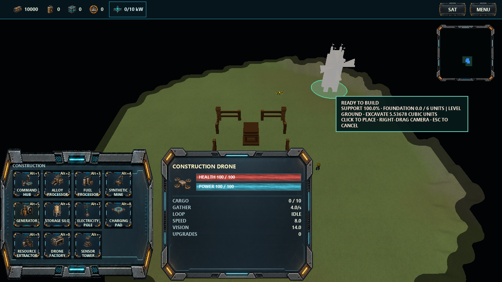
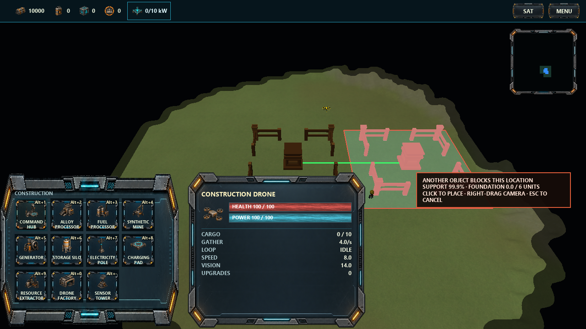

# Building placement audit

Audited 2026-10-22. **The original audit below is a pre-change snapshot.**
Implementation follow-ups at the end record the completed fixes and their verification.
Diagnostic harnesses live in ignored build output.

The current system has both avoidable placement rejections and expensive preview work. It is not
primarily a resource-texture or mouse-event problem. The largest cost is the repeated terrain
solver; moving an excavation preview additionally rebuilds world terrain presentation and invalidates
otherwise reusable vegetation/resource instance buffers. Rendering the ghost as a separate World
also corrupts the real world's resource-cache identity, even without terrain edits. A separate
click-position bug can make a legal placement appear to be refused.

## Scope and reproduction

- Current saved setup, read without modifying it: V2 Continental, seed 1, 15 chunks, China/Spain,
  starting resources scale 2, abundance 1.5. World: 958 entities, 6,929 vegetation instances.
- Hidden 1280×720 OpenGL window, GTX 1070, VSync disabled. Existing asset/driver caches retained.
  Both Release and Debug were measured. No changes to the user's running game were made.
- Actual PlayState/HUD input and rendering, stationary and moving mouse, small and large buildings,
  natural map sites, and analytical flat/slope/bump/cliff surfaces. Starting presentation was warmed
  before timings. The audit session alone received extra alloy so affordability did not hide results.
- Frame measurements include render submission and GPU completion, not regular simulation updates
  or VSync. They are diagnostic frame costs, not a claim about sustained gameplay FPS. Actual UI
  medians use 24 frames after six warmup frames; isolated components use 12 after two warmups.
- Runtime tests focus on current V2 Land buildings. V1, collision, command, persistence and Water/
  Shore branches were reviewed in code. All current building definitions inherit the Land profile;
  Water/Shore support infrastructure is present but no production building authors those profiles.

## Current rules

| Rule | Current implementation |
| --- | --- |
| Placement order | Dominant fitted tilt; tilt + bounded cuts; tilt + cuts + scaffold |
| Building tilt | Total angle capped at 5°, separate from the footprint's raw surface slope limit (normally 10°) |
| Ground contact | 0.25-unit band below the fitted plane; each triangle is accepted/rejected as a whole for height/slope |
| Early tiers | Require essentially 100% connected support; otherwise repeat through later tiers |
| Final support | Strictly more than two thirds connected dry support; water and deeper gaps share the remaining area allowance |
| Excavation | Cut-only; relief 0.75, per-vertex cut 0.6, integrated volume at most footprint area × 0.1, including a 1.5-unit feather border |
| Plane selection | One median gradient direction, reused across tiers; one area-weighted median repair intercept |
| Foundation depth | Maximum 6 units by default |
| Partial water | Land may overlap partial water, but any wet footprint disables fitted tilt and excavation for that footprint |
| Full water tiles | Any fully wet overlapped generation tile rejects a Land building, even if its overlap is small; this follows the accepted contract |
| Terrain repair protections | Do not cut water, protected cliff neighborhoods or existing foundation footprints/collars |
| Other gates | Map bounds, actual object overlap, resources, upgrades, builder ownership/type; UI also gates on explored center position |
| Perimeter access | Terrain-only movement-segment test around the footprint; failure still blocks placement |
| Vegetation | Does not hard-block; accepted placement clears vegetation inside the footprint |
| Ground units/resources | Ground units and live resource nodes hard-block; flying entities and exhausted nodes do not |
| Rotation | No player-controlled building yaw: preview and PlaceBuildingCommand placement shapes use yaw zero |

The two-thirds rule, depth limit, protected water/cliffs and the 5° cap do not need to be discarded
to address the confirmed failures below.

## What should be preserved

The 5° limit is applied to the total fitted plane angle, and accepted previews/buildings share that
plane. Commit still performs authoritative validation, so a stale green preview cannot force an
illegal building into the simulation. Preview cuts modify the renderer's copy, not authoritative
terrain/navigation. Vegetation is cleared at accepted placement, and flying builders do not count
as footprint blockers. Existing cut ownership/save-load/cancellation and construction-progress
handling should remain intact during the performance work.

## Performance evidence

### Actual match view

Initial paired Release/Debug runs on the saved setup:

| Frame | Release median | Debug median |
| --- | ---: | ---: |
| Idle, stationary pointer | 8.99 ms | 21.24 ms |
| Idle, moving pointer | 7.78 ms | 21.07 ms |
| Generator preview, stationary | 9.90 ms | 53.63 ms |
| Generator preview, moving | 9.51 ms | 55.61 ms |
| Command-hub preview, stationary | 20.24 ms | 250.61 ms |
| Command-hub preview, moving | 18.24 ms | 202.62 ms |

The large preview alone exceeds a 16.67-ms frame budget in Release. Debug magnifies the same CPU
work; its idle view already exceeds that budget, so fixing placement alone does not establish
60 FPS in Debug. Moving pointer events themselves measured around 0.01 ms Release / 0.1 ms Debug.
The stationary preview is already expensive because analysis is repeated every render frame.

### Moving excavation

On a valid analytical small-bump site, moving the preview's cut caused terrain uploads costing a
median **1.85 ms Release / 24.49 ms Debug**. Stationary uploads were effectively zero. On the large
cliff/bump fixture the placement query alone took **19.28 ms Release / 289.75 ms Debug**, followed by
about **1.95 / 24.19 ms** of terrain uploads. Overlay/scaffold drawing cost about **0.61 / 4.28 ms**;
it is worth caching, but is not the main bottleneck.

A subsequent actual-map repair-preview run confirmed cache churn:

| Case, 24 measured Release frames | Stationary vegetation uploads | Moving vegetation uploads | Frame median, stationary → moving |
| --- | ---: | ---: | ---: |
| Generator | 0 | 288 batches | 10.62 → 11.43 ms |
| Command hub | 0 | 864 batches | 19.36 → 22.56 ms |

The movement was only a subpixel-to-one-pixel cursor oscillation. Some nearby positions switch
validity/collision state, which also restores the old preview cut and invalidates caches. Resource
instance uploads appeared zero in end-of-frame statistics. That reading is misleading: the ghost
world resets those statistics, as the additional cache audit below confirms. Terrain invalidation
also explicitly marks both vegetation and resource caches dirty.

### Ghost rendering discards the real resource cache

This is a separate confirmed issue, independent of excavation or cursor movement.
[drawWorld](../src/render/Renderer.cpp#L1212) always updates a single persistent
ResourceNodePresentation/resourceNodeCache pair from its supplied World. PlayState first draws the
real world, then calls that method with a newly created ghost World containing just the building.
The second update treats all 952 live resource nodes as removed. On the next frame their return is
an addition, which rebuilds the field identity and GPU buffer allocation.

A resource-focused Release camera with the same real session, warmed and otherwise unchanged:

| Pass sequence | Real-pass chunks rebuilt per subsequent frame | Real-pass batches uploaded | End-of-frame reported uploads |
| --- | ---: | ---: | ---: |
| Real world only | 0 | 0 | 0 |
| Real world, then ghost world | 23 | 108 | 0 |

A separate ResourceNodePresentation probe showed 952 → 0 → 952 nodes and a changed field identity
on real → ghost → real input. Sampling statistics immediately after the real-world draw exposed
uploads that disappear from the counters after the ghost draw. This is resource **instance-buffer**
churn, not resource-ground-texture repainting; the previous texture-paint optimization remains valid.
Use a dedicated preview-model draw that never updates real-world caches, and accumulate/report
cache statistics across passes instead of overwriting them.

### Causes

1. [PlayState](../src/game/PlayState.cpp#L1689) runs the entire terrain query every frame, with no
   cached pose/terrain analysis. Cheap failures such as collisions/affordability are checked after
   the expensive terrain query.
2. [TerrainSupport](../src/terrain/TerrainSupport.cpp#L480) repeats clipping, triangle sampling and
   connectivity work for each tier and again when checking a proposed cut. A query can enter the
   surface evaluator up to five times. Median-height search can perform 22 clipped-area sweeps.
   Polygon/vector allocations and ordered-map connectivity work amplify this in Debug.
3. Rectangle queries already compute a rotated world AABB, but scan a square using the footprint's
   circumradius instead, then clip away the extra triangles. This wastes work, especially on narrow
   footprints. Connectivity could use the known local raster adjacency instead of rebuilding an
   ordered edge map each time.
4. A preview cut is appended to renderer foundations and passed through
   [setTerrainFoundations](../src/render/Renderer.cpp#L2581). That restores/applies terrain pixels,
   marks chunks dirty and invalidates nearby vegetation/resource buffers. The normal scene then
   [flushes every pending terrain upload](../src/render/Renderer.cpp#L2617) synchronously.
5. Ghost rendering changes the persistent resource presentation/cache, as measured above; it must
   not share that update path with an entity-only preview. Frame statistics currently mask the cost.
6. [The overlay](../src/render/Renderer.cpp#L2045) rebuilds its grid, scaffold geometry and expanded
   triangle vertices, and uploads dynamic buffers every frame. The ghost World/entity is also
   rebuilt every frame. These are secondary costs.
7. On commit, [GameSession](../src/simulation/GameSession.cpp#L828) validates placement, then calls
   evaluateFoundation, which solves it again. Accepted cuts refresh navigation heights across the
   whole navigation grid. These affect click/commit spikes, rather than ordinary cursor movement.

## Confirmed avoidable restrictions and correctness failures

### 1. The fitted direction is a heuristic, not a feasibility search

The component-wise median gradient is chosen once and frozen through all tiers. There is no attempt
to find another angle within the allowed 5° when that direction fails.

Analytical reproduction with the current alloy processor footprint and unchanged production profile:

| Plan on the same shallow shelf/bump | Angle | Connected support | Cut volume | Result |
| --- | ---: | ---: | ---: | --- |
| Current chosen direction | 0° | 37.52% | No accepted plan | Reject |
| Diagnostic alternative direction | 2.386° | 95.90% | 7.7563 units³, within the existing 8-unit³ budget | Accept |

The alternative was evaluated by a diagnostic copy of the same validator, changing only its fitted
gradient. Support, slope, excavation, cliff/water protections, depth and perimeter checks remained
active. This demonstrates a missed feasible placement without changing any limits. It does not
mean that every rejected site has an alternative.

### 2. The median repair height can miss a valid, less invasive plane

A 0.5-unit bump with a 3.75-unit source cell under a generator rejects with the ordinary solver
(19.92% reported support). In the same diagnostic validator, raising the chosen repair plane by
**0.1 units** accepts at **99.78% connected support**, with **3.334 units³** excavation inside the
unchanged 8.1-unit³ budget. A 0.125-unit offset also accepts. The 5° cap and cut-depth limits remain
unchanged.

The planner should search a small feasible range of intercepts while honoring base tolerance,
water clearance and cut limits, instead of treating a single median as the only repair solution.
A failed repair attempt should retain its real limiting reason for diagnostics.

### 3. Gentle slopes are reported as cliff overhang

On a 7.13° continuous dry ramp, the generator and processor accept using 5° tilt plus cuts, but the
20×20 command hub rejects at 33.13% support. Changing only its average-cut budget from 0.1 to 0.2
allows a plan: 53.64 units³ removed, 81.88% connected support. The existing budget is 40 units³,
including the border.

This is a real budget restriction, not evidence that the two-thirds cliff rule is wrong. The UI
currently collapses failure of the repair plan into “too much overhang.” Better candidate planes
and exact support math should be fixed before deciding whether a larger shallow-repair allowance
is desirable. The larger budget above is a diagnostic experiment, not an adopted balance change.

### 4. Support area is more conservative than the design wording suggests

The footprint and dry area are clipped, but a triangle is then counted only if its **lowest point**
is within the base tolerance and its whole surface passes the slope limit. It does not clip the
supporting portion against that height band. A partly dry triangle can also be discarded based on
the lower wet part. This undercounts boundary support; largest-connected-area analysis cannot
recover discarded pieces.

Compute the actual dry, in-band support polygon and its genuine shared-edge connections. Preserve
the strict two-thirds threshold for real cliff/water overhang rather than changing it to compensate
for raster/whole-triangle loss. The visual overlay also uses a different test: centroid samples and
semantic slopes averaged over a wider distance with the gameplay slope factor. Green fill is not
proof that the authoritative support test will accept the same region.

### 5. A valid click can silently disappear when the mouse moves

Reproduced through real PlayState input/update/render order:

1. A generator site is terrain-valid, unoccupied, explored and affordable.
2. Click it, then move the pointer over the existing command hub within the same frame interval.
3. Rendering resolves the pending clicked position but also evaluates the newer hover position.
4. The next update gates the clicked position using the newer hover's constructionPreviewValid_.
   Because that hover is blocked, the pending click is cleared without submitting a command.

Observed: 958 entities and 10,000 alloy before/after; the valid click did nothing. A control click
at the same site without the intervening motion produced 959 entities and 9,900 alloy.

The reverse order can submit a blocked click when the new hover is valid; authoritative validation
still prevents invalid placement. Store the clicked pose/intent independently of hover state and
validate that intent. This is a correctness fix, not a request to bypass validation.

### 6. The supposedly skipped access restriction still exists

[TerrainSupport](../src/terrain/TerrainSupport.cpp#L448) still rejects if it cannot find one of 32
terrain-walkable perimeter segments using the configured worker movement domain. Construction
builders are flying drones, and the prior design discussion explicitly skipped blocking building
access requirements. The check also does not establish a real route from a worker or account for
objects, so it provides neither complete reachability validation nor the requested freedom.

Remove it as an acceptance gate if the earlier “allow building” decision remains the policy.
This audit found it in source; no runtime access-only rejection occurred in the sampled opening.

## Other design/UX findings

- **Partial-water policy is restrictive by construction.** Any wet area disables dry-land tilt
  and repair for the whole footprint. This follows the current documented horizontal-water-plane
  contract, but is a design choice worth revisiting for partially wet Land buildings. Local dry
  repairs and a fitted plane constrained by water clearance are more permissive alternatives;
  they need a defined geometry rule, not just removing water safety checks.
- **No manual building rotation exists.** Input currently pans/orbits the camera, and the placement
  command contains no yaw. Terrain API rotation tests do not implement player rotation. Carry yaw
  through preview, collision, command, foundation and entity if this feature is still desired.
- **Ground units block until they move.** Friendly workers are treated as solid occupancy; there
  is no placement reservation/displacement behavior. This is a policy choice, distinct from
  buildings/live deposits that should stay blocking.
- **Diagnostics are misleading/incomplete.** Repair budget, protected-neighbor and other repair
  failures lose their cause and often surface as “overhang.” Collision feedback does not identify
  the blocker. Tooltip excavation values show excessive decimal precision, continually changing
  markup and wrapping the controls over several lines. Prefer a short reason and tilt/ground/
  scaffold status; keep detailed geometric numbers in optional diagnostics.
- **Preview and authority duplicate validation.** Fog/center discovery is preview-side; dynamic
  world/terrain/resources/upgrades are checked separately at commit. Keep hidden information
  protected while sharing rules and returning a structured outcome for the clicked intent.
- **V1 differs intentionally.** It retains legacy fitting and foundation deformation; it does not
  use the V2 tilt/cut/scaffold solver. Avoid accidentally changing its rules during V2 fixes.

## Sampled buildability, not a global map score

A 7×7 grid at ten-unit spacing around player one's start yielded:

| Building | Terrain-valid / 49 | Occupied among those valid | Accepted terrain cut plans |
| --- | ---: | ---: | ---: |
| Generator | 33 | 10 | 3 |
| Alloy processor | 32 | 10 | 3 |
| Command hub | 24 | 13 | 3 |

All terrain rejections in this sample were reported as insufficient support. Doubling the support
band to 0.5 rescued only 2/1/1 otherwise rejected sites; doubling average-cut budget rescued 2/1/2.
These samples include starting buildings, map features and potentially unexplored centers. They
do not establish that the whole map should be buildable, and do not justify blindly relaxing
constants until all 49 sites pass.

## Recommended implementation order

1. **Fix the ghost-cache and click-intent bugs first.** Render the ghost without updating real-world
   resource presentation. Introduce a reusable placement analysis/plan; bind validation and
   feedback to the clicked pose, retain exact failure reasons, and derive the accepted foundation
   from the validated result instead of solving again after spending resources.
2. **Make terrain analysis fast and reusable.** Gather a local surface patch once, reuse it across
   candidate planes/tiers, remove repeated polygon allocations, use actual AABB scan bounds and
   local raster connectivity. Cache exact unchanged pose/footprint/surface-and-protection revision.
   New foundations can change the protected repair area even if they do not change ground height. Continue
   checking dynamic occupancy/resources independently; do not cache a green result indefinitely
   while units can move into it. Generation seed/fingerprint alone is not a surface-change revision.
3. **Isolate all preview rendering from persistent world caches.** First draw the ghost through
   an entity/model-only path, never a replacement World update. Use a bounded scratch height patch
   or preview deformation layer for excavation. Moving/cancelling a preview should not rebuild persistent world
   terrain chunks or invalidate vegetation/resource caches. Only accepted terrain edits should use
   normal terrain/navigation invalidation. Cache/reuse scaffold, ghost and overlay buffers.
4. **Improve feasibility before loosening rules.** Search a bounded set of tilt directions and
   repair intercepts within 5°. Clip support exactly, preserve real connected-support/depth/water
   checks, and keep work inside the preview budget. Include the two confirmed missed-plan cases.
5. **Then tune shallow-ground allowances deliberately.** Consider a separate shallow-foundation
   accommodation band for ordinary continuous terrain and review the average-cut/border budget.
   Preserve the two-thirds cliff/water rule; remove the skipped access gate if that remains policy.
6. **Finish feedback and rotation.** Short player-facing reasons, highlighted blockers, shared
   preview/commit outcomes and agreed rotation controls. Treat partial-water fitting as its own
   explicit design revision.

Verification should include flat ground, localized bumps, continuous slopes, actual cliff overhang,
water edges, narrow/rotated footprints, adjacent foundations, moving blockers, rapid click+motion,
real-world → ghost → real-world rendering with no node-buffer rebuild,
Escape cancellation, save/load and authoritative/preview agreement. Preserve the 5° total angle
and strict real-overhang boundary. Require unchanged-pose analysis reuse and **zero persistent
terrain/vegetation/resource buffer rebuilds from moving an uncommitted preview**. Aim for at most
about 2 ms preview overhead in Release and a moving-preview p95 within 16.67 ms on a view whose
baseline already meets 60 FPS. Treat that as a target to measure after fixes, not a result of this audit.

## Captures

A valid generator requiring a shallow cut; the current tooltip exposes raw excavation volume:

A large preview blocked by an object despite nearly complete terrain support. This image illustrates
feedback, not a claim that the collision itself is incorrect:

## Diagnostic artifacts

`build/debug/audits/BuildingPlacementAudit.cpp`, the copied diagnostic `TerrainSupportAudit.cpp`,
and `build/debug/building_placement_audit.vcxproj` are ignored build artifacts. The ordinary timing
runs are `building-placement-release.log` and `building-placement-debug.log`. Additional actual-map
repair/candidate tests are in `building-placement-extra-release.log`; final plane-offset and click
reproductions are in `building-placement-final-release.log`. The resource-cache pass-order probe is
`building-placement-cache-release.log` (set STRATEGY_PLACEMENT_CACHE_AUDIT=1 in the harness).
Component timings use normal production
code; only the explicitly labelled alternate-plane/direction experiments use the diagnostic copy.
The existing Release terrain-V2, scaffold and placement tests also passed (3/3, 8.72 seconds).
They do not cover the newly reproduced click/ghost-cache/missed-plan failures; promote those
reproductions to regression tests when implementing fixes. No production threshold, algorithm,
save schema or runtime setup file was changed.

## Follow-up: perimeter-access gate removed (2026-10-22)

The user confirmed removal of the skipped gate. TerrainSupport no longer samples perimeter
movement segments or rejects placement for unavailable interaction space. Its unused placement
profile fields, interaction-unit configuration and UI failure reason were removed. Preview and
command validation share this change. Terrain support, water eligibility, foundation limits,
occupancy and generation-time connectivity checks remain in force. The findings above describe
the pre-removal audit snapshot.

## Implementation follow-up (2026-10-22)

Completed in the agreed order, with focused checks between batches:

1. **Click correctness and ghost isolation.** The queued intent owns its recipe, builder IDs,
   heading and resolved position. New hover or rotation input cannot discard or alter it. An
   entity-only model draw replaces the temporary ghost World. Statistics accumulate across passes.
2. **Shared plan and fresh authority.** `GameSession::planBuildingPlacement` returns a structured
   rejection/blocker, spatial footprint, terrain result and foundation. Preview and commit share
   the rules; commit does not trust cached UI state. Accepted foundations consume the validated
   result rather than solving again after spending. Hidden occupancy remains suppressed in fog.
3. **Reusable analysis and temporary presentation.** One clipped local surface patch serves the
   bounded search; medians, base outcomes, cut permissions and raster adjacency are reused.
   Inline convex polygons and conservative extrema fast paths avoid repeated allocations/clipping.
   The geometric cache includes exact pose/profile and surface/protection revision; no-cut
   foundations and same-seed regeneration invalidate it. Dynamic costs/units remain live checks.
   A bounded height/normal texture presents excavation; only accepted edits touch terrain,
   navigation or persistent scenery/node buffers. CPU scratch memory and texture allocation are
   reused. Overlay buffers and the ghost entity are retained across unchanged poses.
4. **Actual support and bounded feasible plans.** Support is the clipped dry height-band polygon.
   Only positive overlapping edge intervals join it. Candidates are the dominant gradient, a
   least-squares plane on the largest connected gentle patch, the mean gradient, a level plane and a blend of dominant/patch gradients;
   duplicate directions are removed. Repair intercepts try the median and two shallow offsets.
   This is a bounded deterministic search, not an exhaustive proof that every feasible plane is
   found. An optimistic support upper bound skips searches only where immutable steep geometry
   makes the existing connected-support requirement impossible. A winning plan retains its
   contact geometry rather than solving again to draw the overlay.
5. **Re-audit before tuning.** The 49-position opening sample now accepts 35/33/25 generator,
   processor/hub terrain sites, versus 33/32/24 originally. Occupancy still excludes 10/11/13 of
   those sites. Sampling includes occupied/unexplored areas; it is not a whole-map score. The two
   confirmed missed plans are now accepted under unchanged limits: processor shelf ~2.00 degrees,
   92.42% support, 2.395 units³ cut; generator bump 99.78% support, 3.334 units³ cut.
   No blanket tolerance/budget increase was adopted. Partial-water fitting and friendly-unit
   displacement remain separate policy choices; current water and occupancy contracts are retained.
6. **Feedback and rotation.** Right-click rotates 45 degrees, right-drag controls the camera and
   Escape cancels. Yaw travels through the command codec, footprint, collision shape, ghost,
   building and foundation; existing save fields persist it. The tooltip names the blocker and
   shows a short tilt/ground/support status. An excavation-budget reason is emitted only for a
   repair that otherwise passed geometry/protection checks. Unsupported and supported overlay
   regions are disjoint, using a compact position/color vertex format; full support is drawn once.
   Save format 1 and generation revision 7 remain unchanged.

### Final performance measurement

Same saved V2 Continental seed-1/15-chunk setup, hidden 1280×720 GTX 1070 window, VSync off,
Release. Each follow-up UI case measures 120 frames after 20 warmups, including GPU completion;
original figures used 24 frames after six warmups. Values are diagnostic render-frame times,
not sustained full-simulation FPS guarantees across every map/camera/hardware combination.

| Case | Original median | Follow-up median | Follow-up p95 |
| --- | ---: | ---: | ---: |
| Idle, stationary | 8.99 ms | 7.34 ms | 8.15 ms |
| Generator, moving | 9.51 ms | 8.04 ms | 9.22 ms |
| Generator cut, moving | 11.43 ms | 8.45 ms | 9.14 ms |
| Command hub, stationary | 20.24 ms | 7.32 ms | 8.16 ms |
| Command hub, moving | 18.24 ms | 7.80 ms | 11.83 ms |
| Command hub cut, moving | 22.56 ms | 11.82 ms | 14.91 ms |

The difficult moving-cut sample is within the 16.67-ms target at p95 (14.91 ms).
One measured frame reached 34.61 ms, so this is not a guarantee that every frame reaches
60 FPS. Its added median cost still exceeds the aspirational ~2-ms preview budget; difficult
moving terrain queries remain several milliseconds. Unchanged analysis is reused, and the
stationary preview remains close to baseline. Debug is validated for correctness, not 60 FPS.

Every sampled stationary/moving preview case recorded **zero vegetation and node-buffer uploads**.
A separate resource-focused real-world -> ghost -> real-world probe reports zero rebuilt chunks
and uploads after warmup, versus 23/108 per frame originally. The click+motion reproduction now
creates exactly one building and spends the 100-alloy cost once.

Logs: `placement-final-long-release.log`, `placement-verified-cache.log`,
`placement-final-global-tests.log` and `placement-final-debug-tests.log` in `build/debug/audits/`.
The [follow-up capture gallery](pictures/building-placement/audit-fixes-2026-10-22/README.md)
contains engine-rendered placement, repair and feedback views.

### Final verification

- Complete Release suite: **36/36 passed**, 97.97 seconds.
- Focused Debug terrain, planning, command placement and renderer suite: **4/4 passed**, 93.36 seconds.
- Final input-guard/capture regression rerun in Release: **renderer integration passed**, 17.64 seconds.
- Both Release and Debug game executables rebuilt successfully; final build logs contain no compiler warnings/errors.
- Regressions include the two missed planes, unchanged-pose reuse, no-cut protection invalidation,
  fresh costs/occupancy, positive-edge connectivity, disjoint overlay regions, clicked-pose/heading
  preservation including a second click, command yaw, save/load yaw, cut cancellation and water/V1 behavior.
- A terrain-depth readback confirms preview deformation matches committed geometry within 2e-6
  framebuffer depth, while renderer CPU terrain stays unchanged during preview. GL checks passed.
- The final source passes `git diff --check`. Runtime match setup was not modified.

## Follow-up: fitted preview angle and floor height (2026-10-23)

The renderer already accepts a rigid foundation-plane orientation for the ghost. The solver
could nevertheless accept a horizontal dominant-gradient fit before trying the overall hillside
fit. It also bypassed excavation for bumps smaller than the support-height tolerance, keeping
the floor at the maximum residual height.

Candidate directions now prefer lower residual relief. Angle-only placement remains first for
an effectively planar surface; otherwise a bounded cut targets the area-weighted ground height,
with existing median/raised-intercept fallbacks when that target fails the cut or support budgets.
An already valid uncut placement remains available if repairs fail. Tilt remains capped at five
degrees, and water/cliff protections and excavation budgets are unchanged. The mean is a search
target, not permission to intersect the ground; circle target moments use clipped-polygon
centroids weighted by analytic disk areas, while acceptance still uses exact footprint geometry.

A resource/collision rejection also no longer removes the ghost's geometric pose. Explored
terrain retains the cached fitted angle and height even while commit is disallowed.

Regression probes cover a high point inside the support tolerance, a gentle overall slope,
actual ghost-versus-committed mesh depth, and visible pixel changes against a horizontal mesh.

Validation: all 36 Release tests passed (114.29 seconds); Debug placement planning,
building placement and terrain V2 passed, and Debug renderer integration passed (83.67 seconds).
Both game configurations rebuilt. The high-point regression lowered the floor from 16.3749 to
16.1157; the gentle-slope probe selected 2.38594 degrees. Engine captures are in
[pictures/building-placement/angle-height-2026-10-23](pictures/building-placement/angle-height-2026-10-23/README.md).

The actual mesh checks measured 28,774 / 29,099 / 69,407 changed depth pixels versus a
horizontal pose at 4.76364 / 5 / 2.38594 degrees, with ghost and placed depths matching.
A fresh 120-frame Release probe measured moving generator cuts at 10.49 ms median / 13.08 ms
p95, and moving command-hub cuts at 14.84 / 17.74 ms. Both had zero vegetation/node uploads.
The largest preview therefore still has occasional frames below 60 FPS; this follow-up does not
claim a consistent 60 FPS on every placement. Logs: `build/debug/audits/angle-final-audit.log`.

## Screenshot 7/8 investigation: natural hillsides (2026-10-23)

Screenshot 8 reports 2.4% connected support, zero tilt and 3.3/6 foundation depth. Changing
only the acceptance fraction from two-thirds to one-half cannot admit that result. Screenshot
7 shows broad uneven ground; a screenshot cannot establish its precise collision geometry or
world position, so the exact site has not been reproduced.

The previous render fixtures proved the mesh follows a nonzero fitted plane, but did not prove
that natural generated hillsides produce such plans. A new CPU-only diagnostic sampled the
current setup (Continental, seed 1, 15 chunks), using the alloy-processor footprint on a 16-unit
grid inside the active map. Dry centers with an eight-unit secant slope between 2 and 25 degrees
were included. This isolates terrain acceptance, not occupancy or complete build permission.

Of 209 sampled hillside centers, 19 passed and zero passing plans tilted more than one degree.
190 rejected plans reported effectively zero tilt. Fourteen rejected plans had more than 50%
connected support; lowering only the fraction would still leave most failures unresolved.

For diagnosis only, allowing raw footprint triangles up to 30 degrees (while retaining the
building's ten-degree total tilt cap and all existing support/cut/depth rules) rescued 118
previously rejected sites; 127 total passing sites then tilted more than one degree. Also
widening the support band to one unit rescued 150 original failures, but this is not a proposed
blanket production tolerance. These diagnostic settings were not applied to game assets or code.
Results: `build/debug/audits/natural-slope.log`; temporary probe lives in the ignored audit driver.

Root restrictions:

- `Piece::gentle` excludes raw triangles above the footprint's ten-degree slope before dominant,
  patch and mean fits. Small generated ramps can consequently disappear from angle fitting even
  where the overall building-scale hillside is moderate. The impossibility preflight can return
  the initial horizontal result before alternative planes are searched.
- Connected support means eligible dry ground within 0.25 units below the floor, rather than
  ground reachable by the metal foundation. Most of a continuous hillside can therefore be
  labeled overhang even when foundation depth remains safely below six units.

Recommended redesign, pending an explicit implementation request: distinguish near-floor contact
from stable foundation bearing on continuous ground; fit building-scale hillsides while using
canonical cliff boundaries to prevent fitting across unrelated shelves; retain ten-degree total
tilt and bounded intersection/earthwork; count permitted foundation anchors separately from real
cliff/water overhang. If the user adopts half support, require at least 50% connected dry bearing
area for that actual overhang test, not 50% of the existing narrow floor-contact band. Regressions
must include natural generated coordinates and visible preview/commit captures, not only planar
fixtures. The screenshot's exact pose still needs reproduction before claiming it is admitted.

## Implemented continuous hillside bearing and half support (2026-10-23)

This supersedes the preceding narrow-band acceptance model. Land requires at least 50% connected
dry bearing, including exact equality. A locally steep ramp triangle remains eligible footing
when it is not a canonical cliff face; its local angle no longer removes it from the overall
hill fit. The ten-degree total building tilt, cut budgets, six-unit authored depth limit,
protected terrain and Land full-water-tile gate remain in force.

`groundContactArea` tracks shallow floor contact separately from `supportedArea`, which now
tracks the selected dry bearing region reachable within the foundation depth. A connected
bearing component must include positive-area shallow contact with the floor. Thus a larger
lower shelf separated by a cliff face cannot replace an inadequately supported upper shelf.
The selected component supplies overlay polygons as well as the displayed support percentage;
base/scaffold selection uses actual floor contact and depth. Canonical cell lookups skip
edge queries for triangles wholly inside one cell, and edge queries clamp to the active map.

The unchanged 209-center natural scan improved from 19 terrain-valid / 0 tilted to 178 valid /
135 tilted over one degree with the final bounded search. These are terrain-only checks, not collision or affordability claims.
A representative former failure at (-64, -160) now fits at 4.09998 degrees. New regression
coverage includes that generated position, rough continuous slopes, contact versus bearing,
exact half support for rectangles and analytic disks, disconnected unanchored lower shelves,
cut/depth protection, and actual ghost/committed geometry. The original screenshots' exact world
poses were not recoverable from the images; they are not claimed as exact reproductions.

See [engine captures](pictures/building-placement/hillside-support-2026-10-23/README.md).

A valid raised scaffold is retained as a fallback while the remaining legal repair intercepts
are checked. Broad bearing must not short-circuit that search at the highest-point floor.
A constrained-average-cut regression verifies that a lower feasible repair still wins.

Final verification: the complete 36-test Release suite passed (108.62 seconds), followed by
four affected placement/terrain/render checks after search pruning (20.47 seconds). Three
Debug placement checks passed (54.73 seconds); both game configurations rebuilt. Compiler logs
contain no C++ warnings/errors and `git diff --check` passes.

Search pruning retains every repair height for the best viable direction, then stops before
trying worse-fitting directions solely for optional earthwork. Alternate directions still
rescue otherwise invalid sites. A median-area bound skips intercepts that cannot reach the
highest surface within the cut limit. Exact rectangular residual bounds skip impossible
full-contact-only evaluations; this proof is deliberately not applied to disk bounding boxes.
The 209-center scan retained 178 valid sites and 135 tilted plans after pruning.

The isolated, 120-frame moving-preview probe measured command hubs at 13.53 ms median /
18.43 ms p95, and hubs over a cut at 16.58 / 18.23 ms. Vegetation and resource-node uploads
remained zero while moving. The unpruned intermediate search reached about 20.64 / 23.27 ms
for the latter case and was rejected. Large moving previews still occasionally fall below
60 FPS; this change does not claim a consistent 60 FPS on all placements.
Logs: `build/debug/audits/hillside-verified-tests.log`, `hillside-final-global-tests.log`,
`hillside-pruned-debug-tests.log`, `hillside-verified-natural-slope.log` and
`hillside-verified-performance.log` in the same audit directory.

## Bounded cut-and-fill before scaffolds (2026-10-23)

Shallow dry sites now try bounded terrain grading before accepting a raised metal frame.
Natural fits retain the ten-degree tilt allowance and ordinary thin-base tolerance of 0.1.
Production limits are 0.6 maximum cut, 0.5 maximum fill, 0.1 average excavation and 0.15
combined average earthwork, with 0.75 residual relief and the existing feather width.
Larger differences retain mixed grading/scaffold or ungraded scaffold fallbacks. Water,
canonical cliffs and protected neighbouring foundations retain their existing protections.

Preview and commit use the same signed terrain edit. Accepted edits replay deterministically
from base heights; cancelling restores terrain and remaining overlapping edits. The new
fill cap participates in save data, checksums and cache invalidation. Save format remains 1;
older development saves lack the mandatory field and require a new match. User runtime
setup and saves were not modified or deleted.

All 37 Release tests passed (94.97 seconds), followed by all four affected Debug tests
(53.21 seconds). Both game configurations rebuilt. Render regression verifies preview/commit
terrain depth, cancellation and absence of scaffold geometry on a shallow graded site.
See [representative engine captures](pictures/building-placement/grading-2026-10-23/README.md);
these do not reproduce the screenshot's exact coordinates.

The isolated 120-frame performance probe measured moving generators at 10.26 ms median /
12.92 ms p95, moving hubs at 14.40 / 22.57 ms, and moving hubs over a cut at 18.17 / 24.07 ms.
Vegetation and resource-node uploads stayed zero during preview movement. The additional
grading search has a measurable cost on large moving previews; consistent 60 FPS remains
unresolved and these results do not claim a performance improvement. Logs are
`build/debug/audits/grading-global-tests.log`, `grading-debug-tests.log` and
`grading-final-performance.log`.

## Distant placement and satellite exploration (2026-10-23)

The green-but-unplaceable distant site was caused by two different discovery sources: rendering
fabricated a fully revealed satellite Player, while click resolution checked the owner's actual
discovered cells and silently discarded the intent. There is no placement-distance gate to remove;
accepted buildings already send the assigned drone toward their construction interaction range.

Satellite now grants authoritative player coverage through research. Low resolution permanently
explores all terrain, and high resolution adds continuous live global vision. Preview and click
both consume the same real discovery map. An unexplored click reports the existing localized
reason instead of silently disappearing. No terrain, support or navigation gate was added.
See `GAME_DESIGN.md` for the research, persistence and cost contract.

Validation: all 38 Release tests passed (108.97 seconds). The final global-intelligence change
passed five affected Release checks; tier ordering passed its catalogue and rendered checks.
The final quickload change passed satellite, persistence and renderer checks in Release
(14.59 seconds) and Debug (104.09 seconds). Both game builds are updated, compiler checks
have no C++ warnings/errors, and `git diff --check` passes. Rendered controls were inspected:
[engine captures](pictures/satellite-2026-10-23/README.md).

Logs in `build/debug/audits/`: `satellite-global-tests.log`, `satellite-verified-tests.log`,
`satellite-ui-tests.log`, `satellite-load-final-tests.log` and
`satellite-load-final-debug-tests.log`. Release and Debug renderer tests must run serially;
an existing match-preparation fixture shares its temporary filename across configurations.

## Preview budget and remembered-draw optimizations (2026-10-23)

Grading candidates now compare their completed excavation/fill totals against the existing
budgets before rebuilding the repaired surface and evaluating its connected support. An
over-budget candidate cannot be accepted, so it retains the ungraded fallback without that
evaluation. Bounds, tilt, support, protection and grading budgets are unchanged. A candidate
that violates both budget and support can now report the known budget failure first.

Remembered-only models are skipped entirely when the player has live global coverage.
Otherwise, conservative bind-pose model spheres reject off-screen memory and records whose
complete bounds are live-visible. Bounds include model scale, static mesh node transforms,
grounding and rotation. Fog bounds include neighboring texels because the exploration texture
uses linear filtering. Large objects crossing a camera or fog boundary remain drawable.
The sphere radius is accumulated during the existing model upload vertex walk; this does not
add an asset scan or a new visibility index. Intelligence, saves and checksums are unchanged.

Renderer regression uses GPU primitive queries to verify that live/global and off-screen memory
produce no draws, explored unseen memory remains, and scaled objects crossing camera/fog
boundaries are retained. Existing terrain grading/planning regressions cover bounded fallback,
tilt, cut/fill, protected footing and exact preview/commit geometry.

The paired Release probe used seed 1, 15x15 chunks, 958 entities, 1280x720, high-resolution
satellite, 20 warmup frames and 120 measured frames per case. Moving a graded hub improved
from 19.24 ms median / 20.96 ms p95 to 16.81 / 19.54 ms. The world-render CPU section fell
from 3.89 to 0.34 ms median. A stationary hub improved from 10.64 to 8.10 ms. Timing includes
simulation updates and a GPU completion wait; individual section savings are not additive.
Consistent 60 FPS is still not achieved for every large moving preview.

In the 49-site hub terrain-query sample, p95 fell from 19.10 to 13.01 ms and maximum from
30.99 to 15.94 ms. Across all 147 sites (three footprints), valid/invalid decisions and accepted
height, gradient, support area, depth, grading presence and cut/fill volumes matched exactly
using hexadecimal floating-point output. The complete 38-test Release suite passed in 104.23
seconds. No terrain generation, placement limits, save schema or simulation checksum changed.
All three affected Debug checks also passed; both game configurations rebuilt without C++
warnings/errors. `git diff --check` passes.

Logs in `build/debug/audits/`: `preview-optimization-before.log`, `preview-opt-after.log`,
`preview-opt-global-tests.log` and `preview-opt-debug-tests.log`.

## Top-bar satellite shortcut (2026-10-23)

SAT now instantly grants the next missing tier for free: low resolution, high resolution,
then no-op. It preserves selection/camera and does not require a hub. Both paid hub upgrades
retain their costs, duration and prerequisites. If the granted tier is queued for research,
that order is removed and its reserved costs refunded; unrelated production remains queued.

The action submits `AdvanceSatelliteCommand` at appended codec index 26 with reserved entity 0.
The authoritative player command chooses the next tier when applied, so rapid clicks progress
in sequence instead of requesting the same tier twice. It writes existing player research data;
save format and existing researched/granted coverage semantics are unchanged. Tests cover the
codec, owner isolation, low/high progression, no funds/no hub, saturation, queued refunds,
save/load and real top-bar clicks without changing the drone selection.

Validation: all 38 Release tests passed (110.32 seconds). Final command dispatch cleanup passed
the three affected Release checks (35.83 seconds) and the Debug satellite check. Both game builds
are updated, final build logs have no C++ warnings/errors, and `git diff --check` passes.
Logs in `build/debug/audits/`: `satellite-shortcut-global-tests.log`,
`satellite-shortcut-final-tests.log` and `satellite-shortcut-final-debug-tests.log`.

## Explored resources and decoration (2026-10-23)

Static resources and decoration now use discovered-terrain fog, with 42% lighting outside live
vision, matching terrain. This makes low-resolution satellite exploration show the static
landscape without exposing enemy units. Resource fields and vegetation keep instanced/chunked
rendering; active resource snapshots no longer produce duplicate remembered draws. Explored
resources can be picked/outlined, field hover uses discovery, and minimap resources use muted
markers. Unknown ground still hides them. No simulation or save-schema change is needed.

Only the directly changed `explored_static_visibility` regression ran. It passed in 1.14 seconds,
checking rendered resource/vegetation pixels, explored/live brightness, hidden enemies,
resource picking and static buffer reuse. Both game configurations rebuilt without C++
warnings/errors. Logs: `build/debug/audits/explored-static-verified-test.log`,
`explored-static-verified-build.log` and `explored-static-debug-build.log`.
