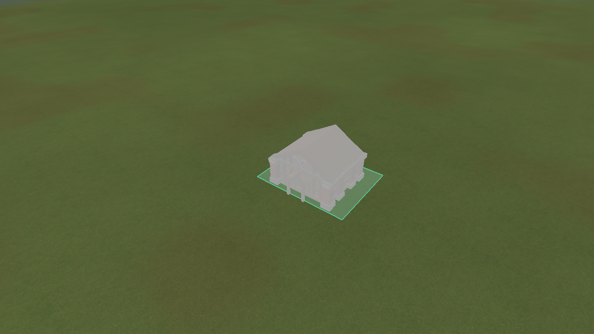
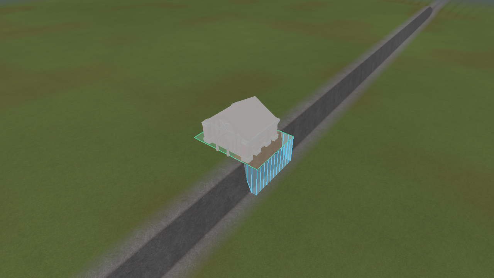
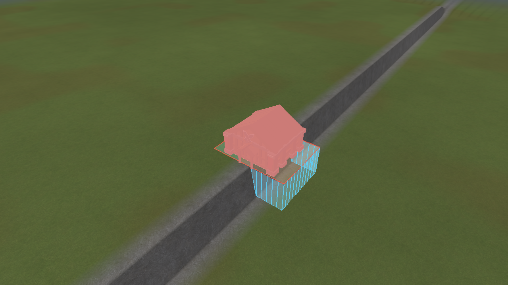
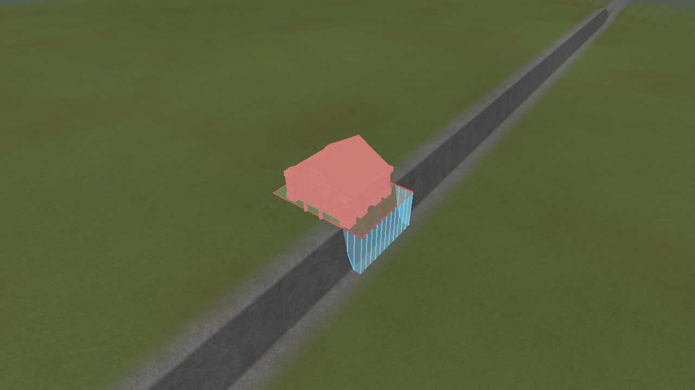
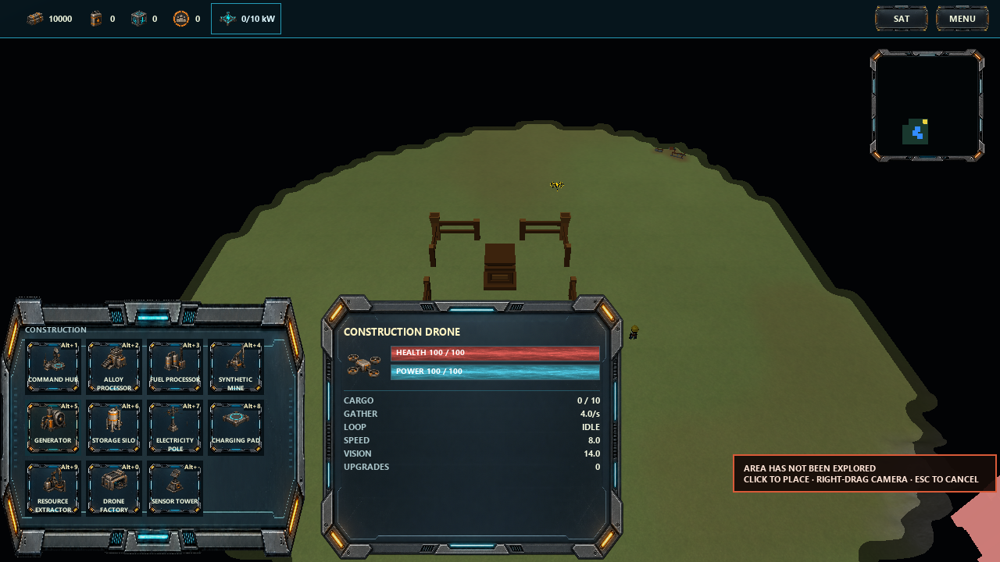
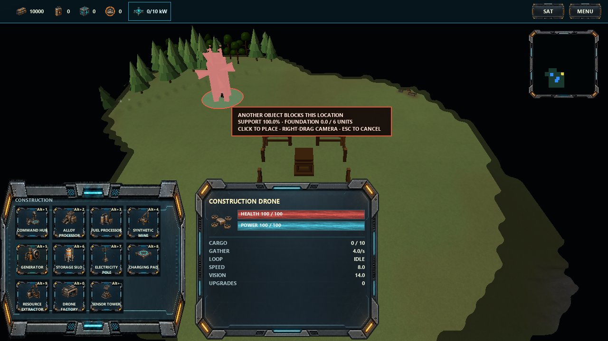

# Building placement feedback

Actual renderer captures, 2026-10-22. Implements placement audit points 1–3.

## Gentle-ground correction

The subsequent screenshot review exposed a strict-horizontal-support problem: a 0.1-unit gentle
rise could report essentially 0% support. V2 now counts connected dry triangles within the building's
`supportHeightTolerance` below the placement plane, subject to its footprint slope limit. The
default in `assets/gameplay/buildings.json` is 0.25 world units. Zero restores strict level support.
Lowest clipped triangle height is tested so cliff faces cannot count through a high vertex alone.

A shallow base covers the small difference while the building stays level and terrain heights stay
unchanged. True cliff/water overhang, connected-support, fully wet tile and maximum-depth checks
remain. Regression tests reproduce the former rejection, verify acceptance and tighter authored
tolerance, and retain strict one-third cliff rejection and water/depth checks. The preview uses the
same authored tolerance and slope limit for its illustrative fill.

## Footprint and foundation preview

Green marks supported ground; amber marks illustrative unsupported portions. Cyan walls and lines
show the proposed V2 foundation extending to the existing bed. The footprint border turns red when
placement fails. These are transient overlays: no foundations or terrain edits are committed by
previewing. Fill classification uses local samples for presentation; exact clipped triangle areas
remain authoritative. V1 markers follow the fitted plane instead of applying V2 support rules.

The analytical cliff fixture is deliberately simple so footprint and support behaviour are visible.
It does not represent the generated map's cliff composition.

## Controls and command outcomes

Escape cancels the tool. Right-drag retains camera control while placing; a short right-click leaves
the tool active and does not issue a move order. Submission leaves the tool open while awaiting a sequence-correlated simulation result;
additional clicks cannot submit another request during that wait. Acceptance closes the tool.
Rejection keeps it open and displays its reason for four seconds, allowing a deliberate retry.
Cancelling the preview after submission does not undo an already submitted construction command.

The cursor panel reports support to one decimal place, rounding down so a rejecting two-thirds
boundary cannot appear as 67% support. It shows foundation depth and its building-specific limit.
Insufficient support, excessive depth and missing interaction space have separate explanations.
Resource loss, missing requirements, collision, bounds and lost builders also produce command
feedback. Placement costs, footprint sizes and save/generation versions are unchanged. The original
feedback pass preserved terrain rules; the subsequent shallow support band is described above.

## Verification

The subsequent camera-control preference change passed Release and Debug renderer/input checks.
Right-click and right-drag keep the placement tool active; Escape cancels it. Captures above use
the updated control hint.

- Release and Debug game builds succeeded without compiler warnings.
- After the gentle-ground correction, all 34 Release tests passed (122.53 seconds).
- Focused Debug geometry, placement and renderer checks passed (3/3, 73.68 seconds).
- CPU regressions verify correlated acceptance/rejection, no spending/spawning on rejection,
  occupancy changes, lost builders, insufficient resources and transient event consumption.
- Actual PlayState/RmlUi input checks exercise recipe selection, screen-edge bounds, right-click
  and camera drag keeping placement active without a move order, Escape, collision between preview and commit, retained tool
  and reason after rejection, and a successful retry that closes the tool.
- Renderer checks cover valid cliff support, invalid overhang and excessive foundation depth,
  alongside existing camera-motion and OpenGL checks. `git diff --check` passed.

Point 4 remains skipped at the user's request. The subsequent
[metal scaffold pass](scaffolds/README.md) implements V2 foundation art and construction stages.
This does not add final-world route proofs, a placement rotation control or construction queues.
