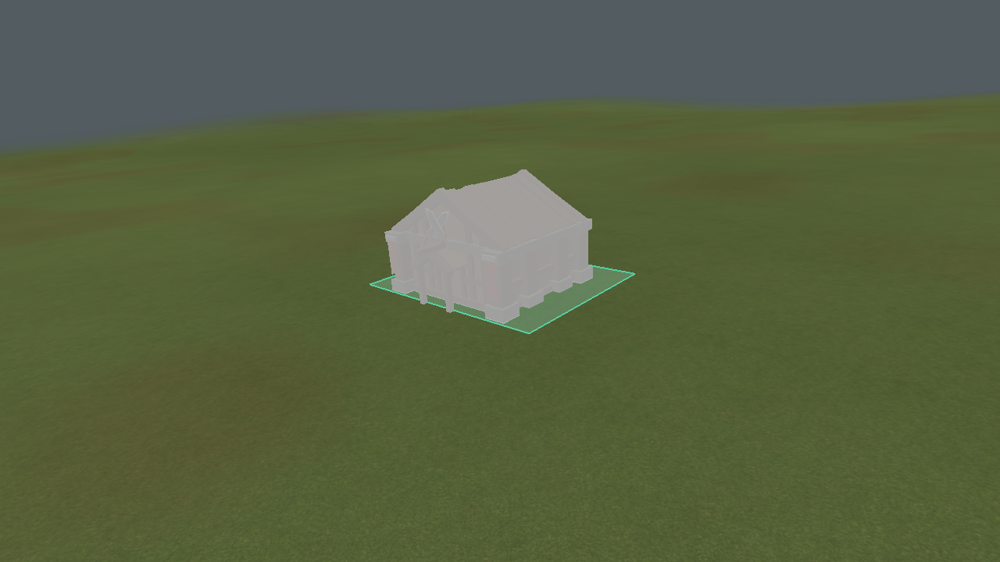
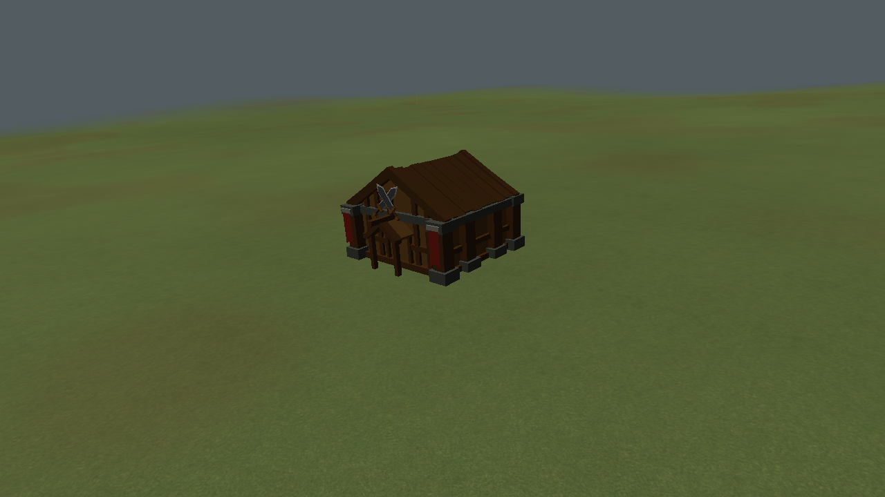
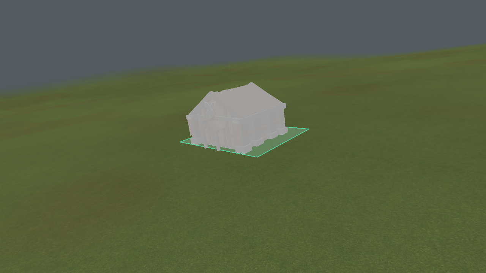

# Fitted placement angle verification

Engine captures of the same gentle-slope placement before and after committing. The ghost
uses the actual `drawPlacementGhost` path; the completed building resolves its stored foundation.
The render test compares their depth buffers and also checks that the tilted mesh changes more
than 100 pixels compared with the same mesh held horizontal.

## Raised ten-degree limit

The live catalogue and hard clamp allow ten degrees. On this slope the preview fits
9.46232 degrees without excavation. The render test confirms the ghost and committed depth
buffers match; tilt changes 32,561 pixels compared with the same mesh held horizontal.

