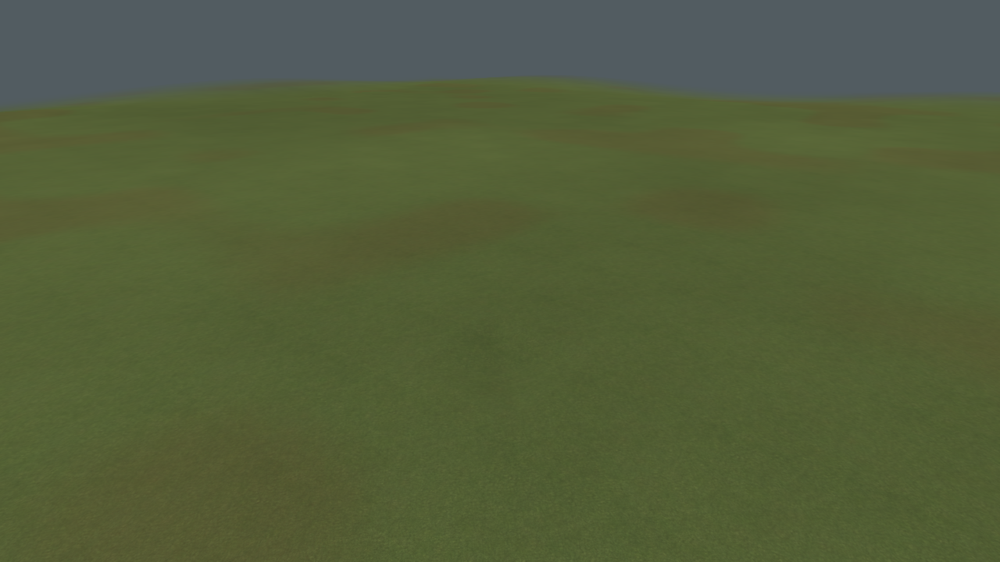
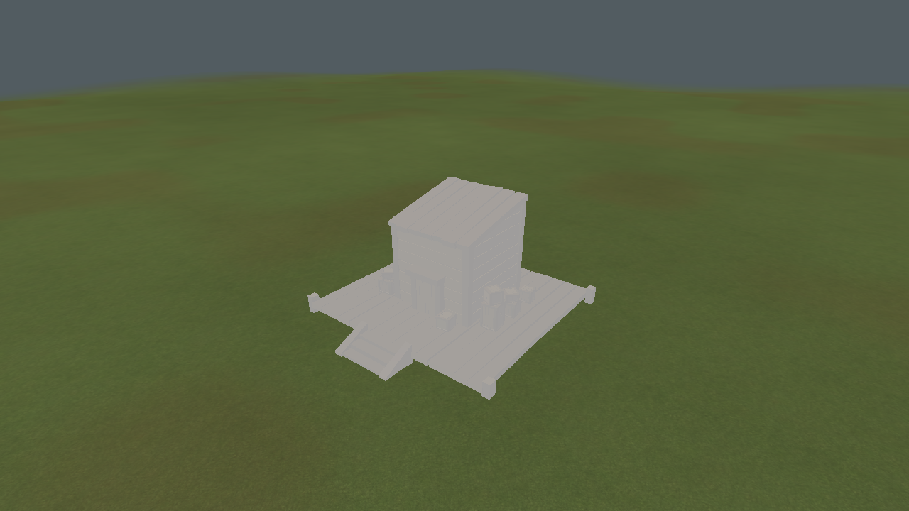

# Bounded terrain grading

Actual engine building-pad captures on a shallow dry depression. The accepted plan cuts and fills
within the production budgets without a raised metal scaffold. This is a representative fixture,
not a reconstruction of the exact screenshot camera or world coordinates. Render regression
compares preview and commit terrain depths, then verifies cancellation restores the original.

