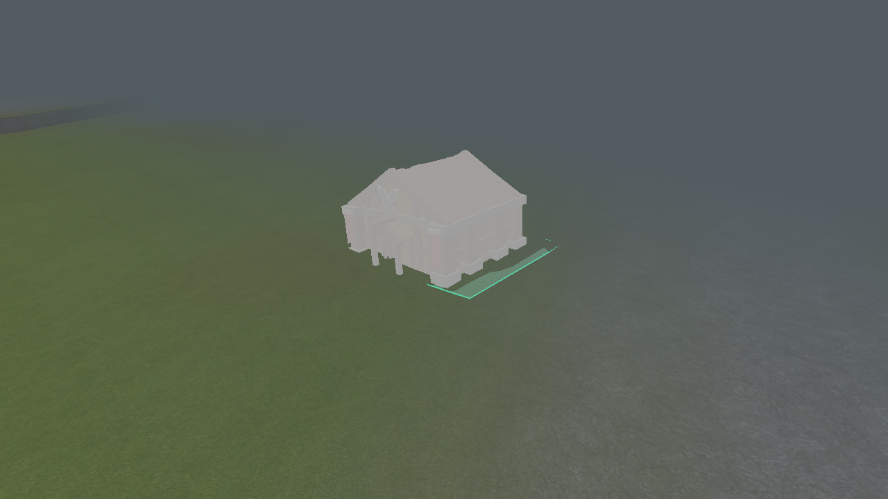
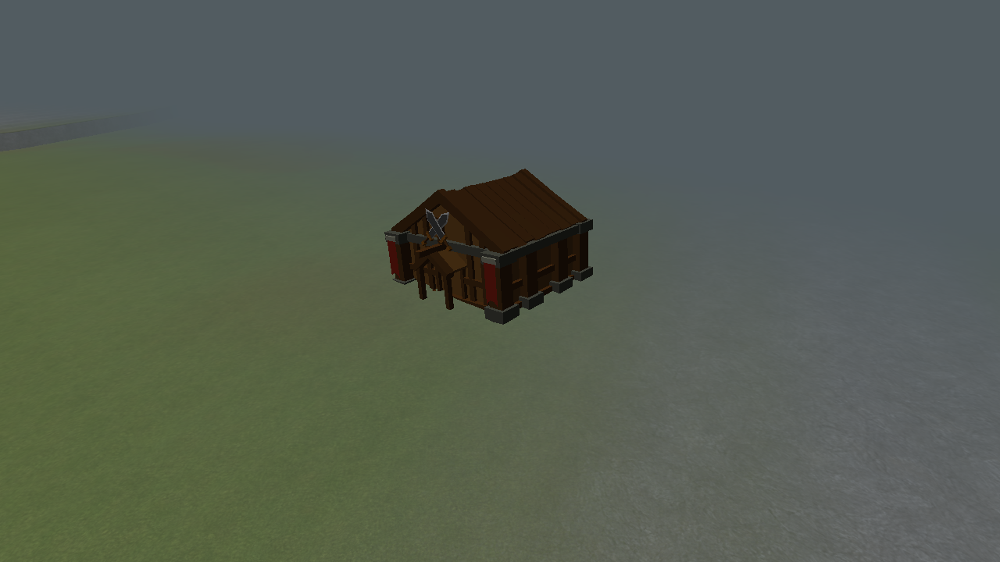

# Continuous hillside support

Actual engine captures. The natural case uses Continental seed 1, 15 chunks, at (-64, -160),
with an alloy processor fitted at about 4.1 degrees. This location previously failed with zero
tilt. Ghost and committed mesh depth are compared in the render integration test.
These are representative generated coordinates, not a reconstruction of the user's exact
screenshot camera or cursor position.

