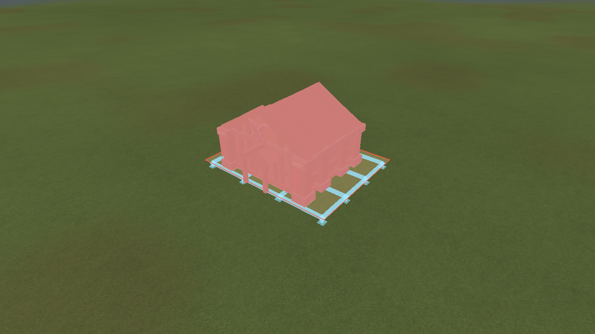
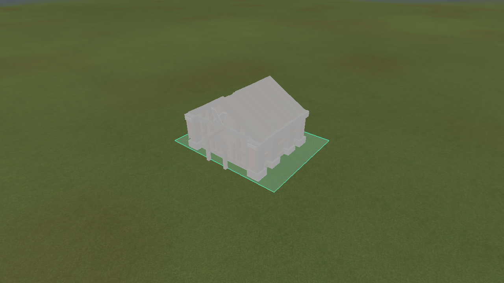
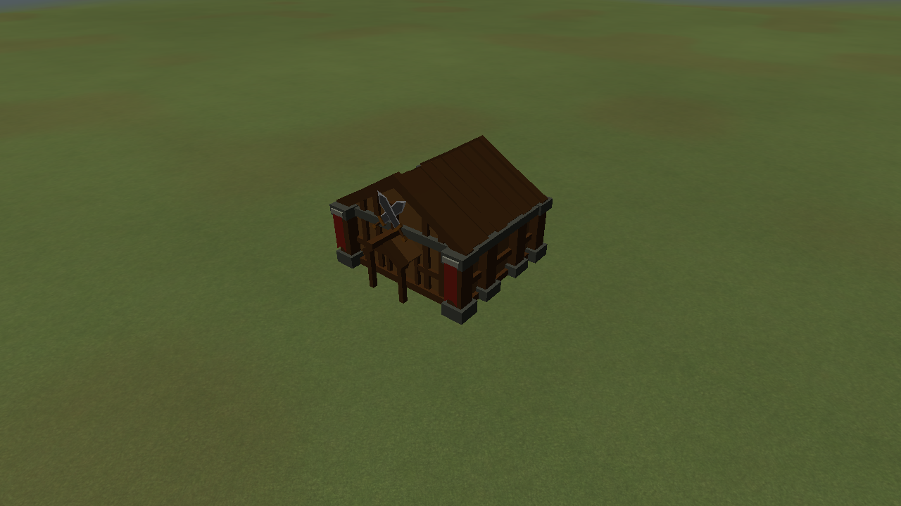

# Bounded terrain levelling

Actual engine captures, using the Alloy Processor and a deliberately simple dry-terrain fixture
with one half-unit bump. This recreates the rejected shallow bump case without depending on a
particular generated map position.

[Cancellation](cancelled.png) restores the original ground and its previous rejection.

The JSON-backed default Land placement policy permits cut-only repairs when footprint relief is at
most 0.75 units, individual cuts stay within 0.6 units, and total excavation is at most footprint
area × 0.1. The total includes the feathered edge, not just the building interior. A zero relief
limit disables levelling. Other support types retain their existing contracts.
Relief already accommodated by the ordinary 0.25-unit base band retains that existing behavior;
the repair path is used for larger shallow irregularities that meaningfully lower the proposed floor.

The target is the area-weighted median elevation of the clipped footprint. Existing low ground is
not filled. The proposed result must still pass the connected-support ratio, foundation depth,
eligibility and interaction checks. A plan must meaningfully lower the floor; it cannot excavate
only the outside border when no adjustment is needed beneath the building.

The 1.5-unit feather starts beyond a raster-sized collar, ensuring triangles crossing the footprint
edge do not poke through the floor. Changed vertices and their neighbours must be dry. Cliff drops
larger than the shallow relief limit block excavation, including in the collar. A half-unit bump
may be repaired even if the generator labels its short edge a cliff. Large cliffs, water surfaces,
water beds, and the canonical navigation topology remain unchanged. Cuts may not undermine an
existing foundation's footprint or adjacent supporting vertices.

Preview evaluation does not mutate the simulation. The renderer applies a temporary foundation
overlay before drawing the scene, uploads the affected terrain chunks together, and invalidates
nearby decoration/resource instance transforms. Picking and command placement use the authoritative
surface so the preview does not feed back into its own evaluation. Stationary previews reuse the
same adjustment. Leaving placement or moving the preview restores its old region.

Accepted placement applies the cut immediately, after all authoritative collision, upgrade and
resource checks. Construction progress does not move the floor or repeat excavation. The cut is
owned by the foundation: cancellation/destruction removes it and restores the generated surface,
retaining any other foundation cuts. Absolute cut targets compose by minimum height, so they do not
accumulate or fill each other. Path rise costs refresh after authoritative changes.

Format-1 saves now include optional `levelsTerrain`, `levelingBlendWidth` and `levelingMaximumCut`
foundation fields. Legacy saves default to no excavation. Accepted floor/shape/blend/cut data
reconstruct the same overlay on loading and contribute to the authoritative checksum. V1's
existing deformation behavior is unchanged.

Tests cover bump acceptance, read-only evaluation, hard depth/volume/relief limits, shallow steps,
larger cliffs, water, neighbouring foundations, circular/rotated footprints, progress reuse,
restoration and saved data. Command-level tests exercise insufficient resources, actual excavation,
normal spending and cancellation refunds. Renderer checks capture all four phases and confirm
that the repaired fixture does not generate a scaffold mesh.

Final verification: Release and Debug game builds succeeded without compiler warnings. All 35
Release tests passed in 130.33 seconds, and focused Debug terrain, command-placement and renderer
checks passed (3/3, 53.28 seconds). Final captures above come from that Release renderer run.
`git diff --check` passed. Logs are under `build/debug/audits/leveling-verified-*`.
