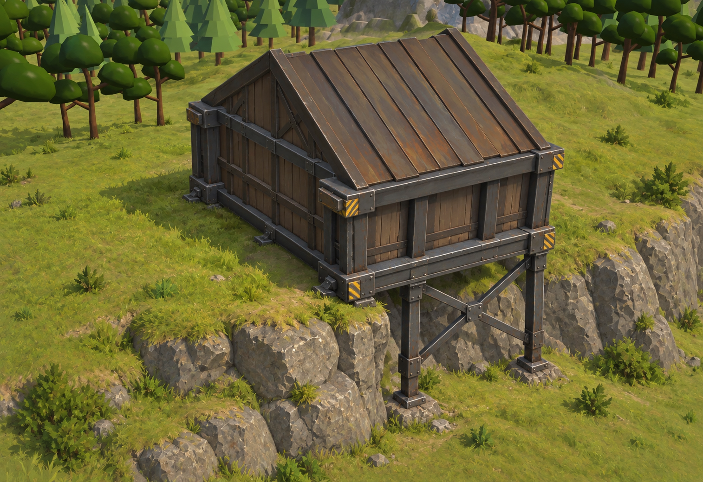

# Metal scaffold foundation concept

Generated on 2026-10-22 using the built-in image generation tool. This is a design proposal, not an
engine capture or an implemented feature. Reference: the user's `C:/Users/Brord/Desktop/Screenshot_5.jpg`.

## Final generation prompt

Use case: stylized-concept. Create ONE landscape sample concept image for the metal scaffold building foundation of this RTS game. Use the reference screenshot only for the game's readable 3D art direction, compact pitched-roof warehouse silhouette, grassy terrain and low polygon trees. The red placement tint and UI are NOT part of the concept: omit all UI, outlines, text and labels. Show a finished compact industrial warehouse in its natural weathered brown/dark steel colors, on a grassy cliff edge. Around THREE QUARTERS of its footprint rests directly on the upper grassy ledge; only the front quarter overhangs a natural 2-3 metre rocky drop. Camera is a close three-quarter elevated RTS view looking toward the exposed front and side, with enough visibility beneath the overhanging quarter to clearly assess the engineering. Foundation: thin capped steel deck exactly inside the building footprint, a reinforced dark steel perimeter I-beam, short adjustable steel feet on the nearly level grounded side, and sturdy vertical steel columns plus clear diagonal X cross-bracing ONLY under the overhang. Columns terminate with small metal base plates on the existing lower ground. Open space and natural rock remain visible behind the scaffold. Include credible joints, bolted gusset plates and structural load paths; support both exposed corners. Weathered charcoal steel, restrained rust, a few tiny worn yellow hazard stripes on exposed beam corners, no bright decorative lighting. The platform should be modest and integrated with the building, not a broad floating deck or tall tower. The cliff should remain natural and unchanged, with irregular rock and grass; no giant artificial platform, no solid concrete retaining walls, no stairs, no roads, no extra buildings, no people. Readable low-to-medium polygon game concept rendering with natural textured materials, soft daylight, clear shapes rather than photorealism. Center the building large enough to see the structural members, include a little surrounding grassy terrain and trees for context. This is an illustrative design proposal, not a screenshot claiming implementation.
