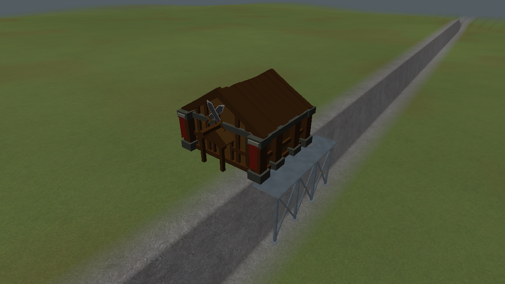

# V2 metal scaffold foundations

These are actual engine captures from `renderer_integration_tests`, using an analytical four-unit
cliff fixture to make the foundation visible. The warehouse is the existing Alloy Processor model;
the terrain fixture is deliberately simple, rather than a proposed map style. The approved art
concept remains [one directory above](../metal-scaffold-foundation-concept.png).

Dark steel columns terminate in small bed-anchored footplates. Exposed bays receive X braces and
small gussets; a thin closed deck supports the building. Ground beneath the footprint stays intact.
Subtle rust and sparse hazard collars keep the structure readable without a bright perimeter stripe.

| Capture | What it verifies |
| --- | --- |
| [Placement preview](preview.png) | Shared scaffold structure with cyan preview tint and support overlay |
| [Early construction](columns.png) | Feet and columns appear first, without lowering the building |
| [Bracing stage](braces.png) | X braces follow; the frame/deck assemble later |
| [Completed](completed.png) | Capped deck and weathered structural steel |
| [Restored](restored.png) | Foundation reconstructed from retained data when staging the map |
| [Circular footprint](circle.png) | Circular deck and radial/perimeter structure, with rotation |
| [Partial water coverage](shore.png) | Shore foundation over a wet cliff edge, with columns continuing to the submerged bed |

`ScaffoldGeometry` is CPU-only and shared by preview/world rendering. It respects rotated rectangle
and circular bounds, emits closed members with flat normals, and avoids unnecessary columns on
fully supported ground. Floating buildings retain their existing no-bed-foundation behavior.

Static GPU buffers are cached per foundation. Construction changes a shader progress value; it
does not rebuild or upload the mesh. Tests exercise progress, adding/removing another foundation,
moving the same identity, and staging the map again. Geometry changes invalidate only that mesh;
terrain replacement reconstructs against the new bed.

This presentation pass does not change V1, terrain/water geometry, placement acceptance, resource
costs, interaction rules or saves. Scaffold beams are visual geometry; this does not add a separate
beam collision/navigation system. Placement point 4 remains skipped as requested.

Verification: Release and Debug game builds succeeded without compiler warnings. All 35 Release
tests passed in 147.54 seconds. Focused Debug geometry and renderer/input checks passed (2/2,
44.37 seconds). Coverage includes valid/invalid placement, shallow ground, unchanged terrain,
rotated/circular bounds, nondegenerate faces, cache reuse/invalidation and OpenGL errors. The
shoreline camera was then refined and its Release renderer check repeated for the final capture.
