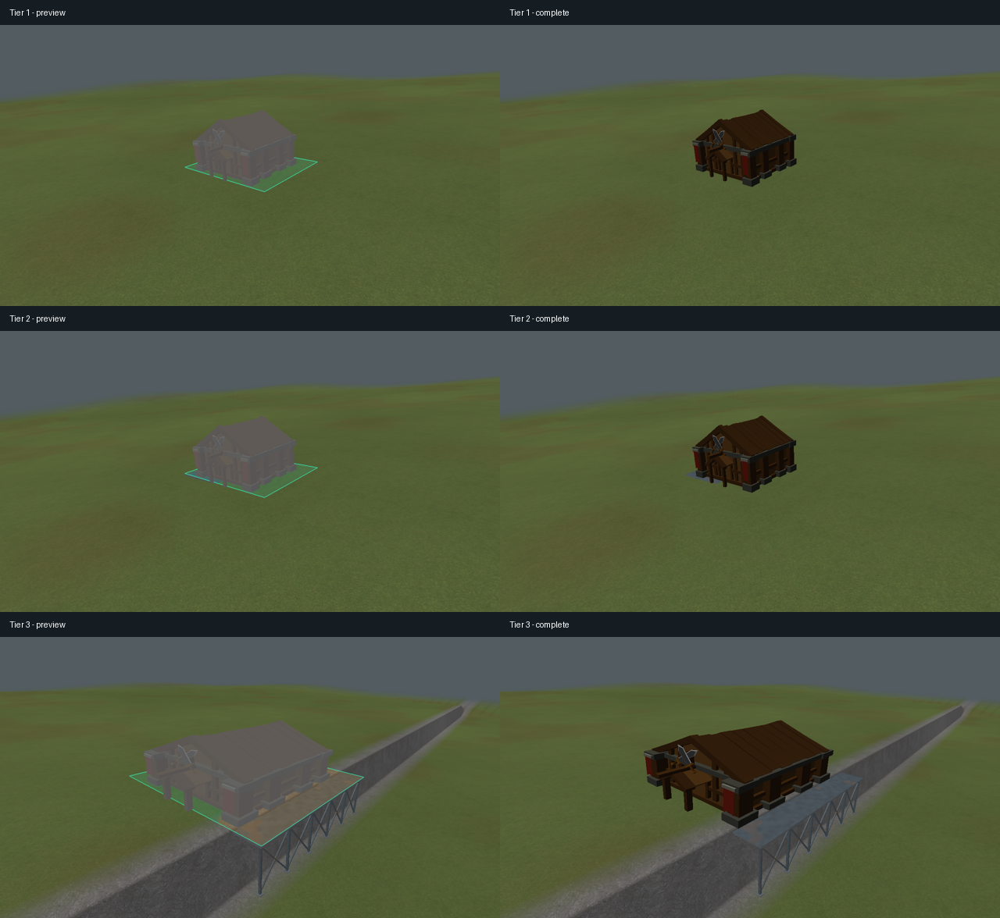

# V2 placement tiers

Actual engine captures from `renderer_integration_tests` at 1280×720. Left: accepted preview;
right: completed building. Synthetic terrain isolates each rule; custom test footprints are used
rather than changing building balance data. The combined-case model is scaled to match its test
footprint.

1. A 4.76° natural slope: tilt alone, no excavation or scaffold.
2. A 7.13° natural slope: cap building tilt at 5°, then make the bounded residual cut.
3. A 2.39° shelf with a small high spot and a four-unit cliff: tilt, a small cut and metal supports.

CPU tests check rotated rectangular and circular footprints, the combined-axis angle cap,
first-valid-tier selection, accepted foundation gradients, excavation budgets and save/load surface
reconstruction. Renderer tests exercise preview/complete transforms, scaffold creation and OpenGL
errors. Water and V1 retain their existing placement contracts.

Verification: all 35 Release tests passed (145.94 seconds). After capture framing and test warning
cleanup, the terrain and renderer checks passed again (2/2, 23.71 seconds). Release and Debug game
builds succeeded. Debug terrain, placement and renderer checks passed (3/3, 60.75 seconds).
Logs are under `build/debug/audits/tilt-*`.
