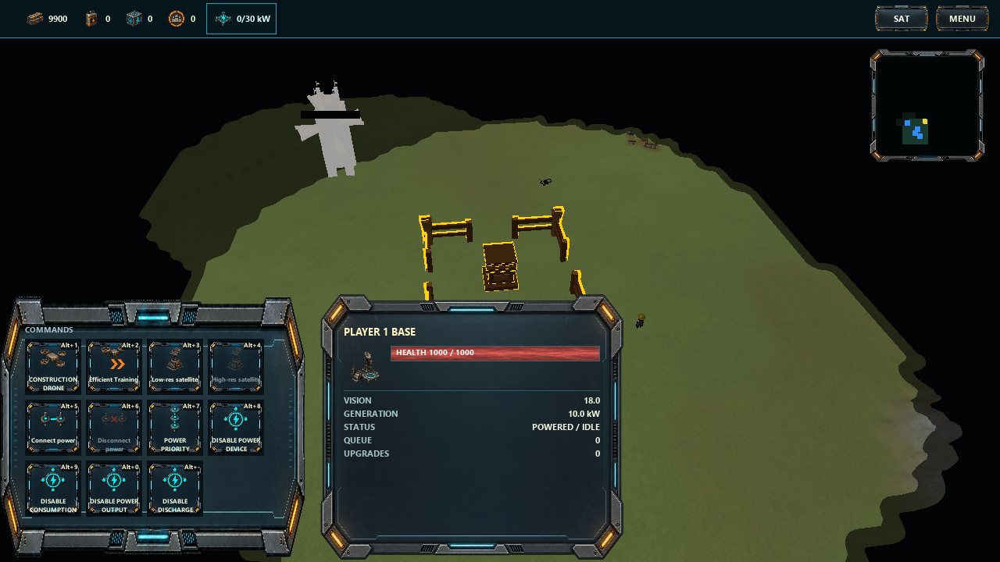
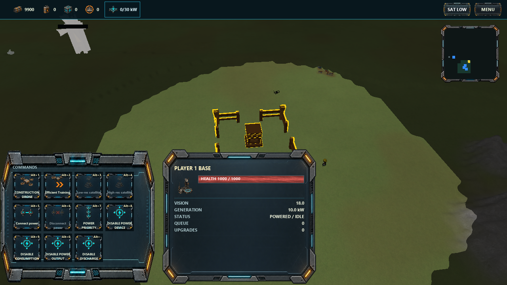

# Satellite research controls

Historical engine captures at 1280x720, before the top-bar shortcut revision. Select the command
hub to access these paid research controls. The SAT button now grants low resolution and then
high resolution instantly for free, without changing selection.
Low resolution is listed before high resolution; SAT LOW confirms permanent exploration.
These fixtures deliberately have no Fuel, so the high-resolution purchase is disabled.
The simulation regression separately verifies global live enemy vision after high-resolution research.

