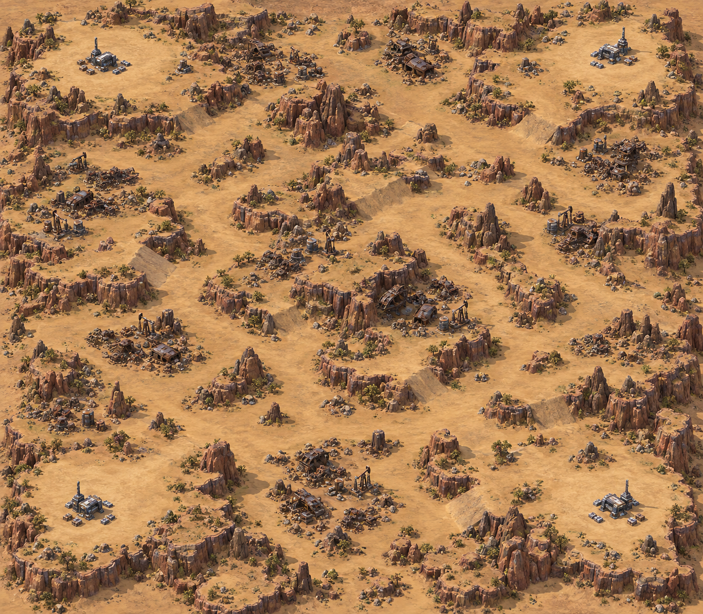
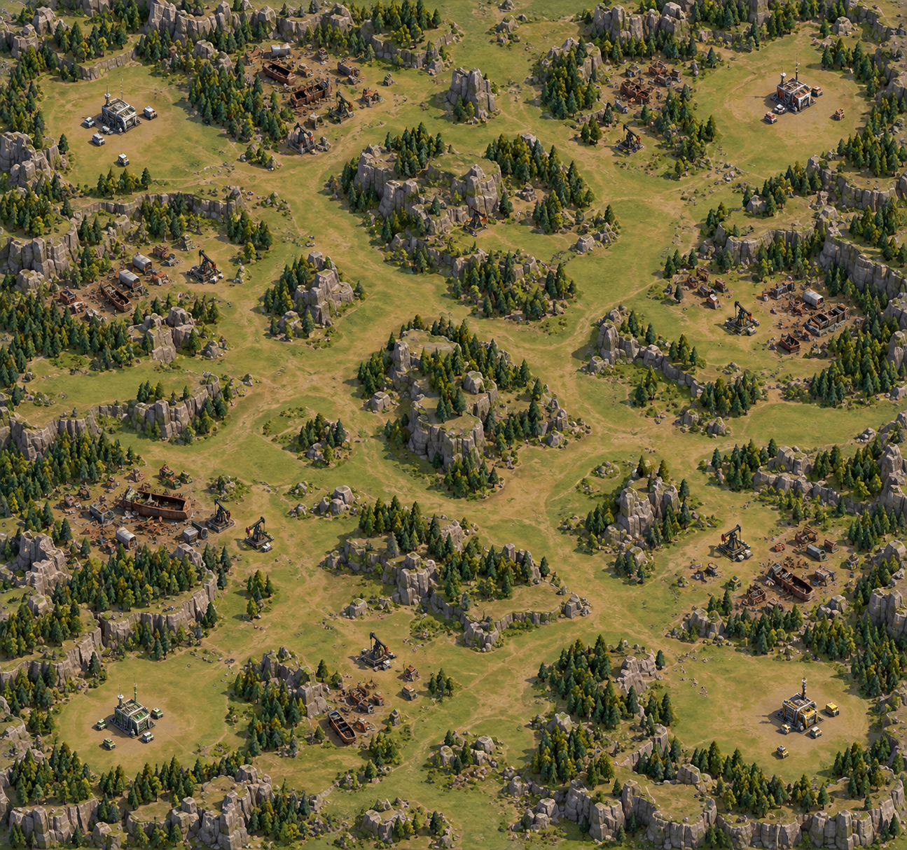
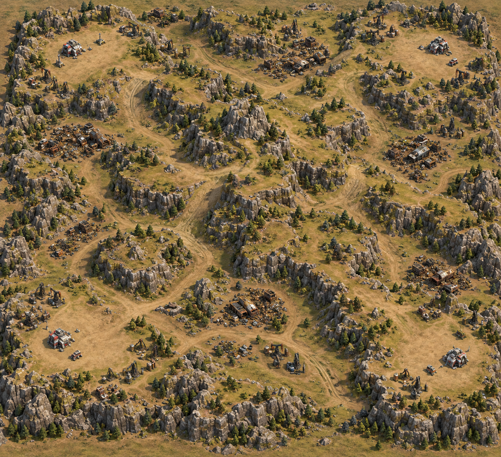
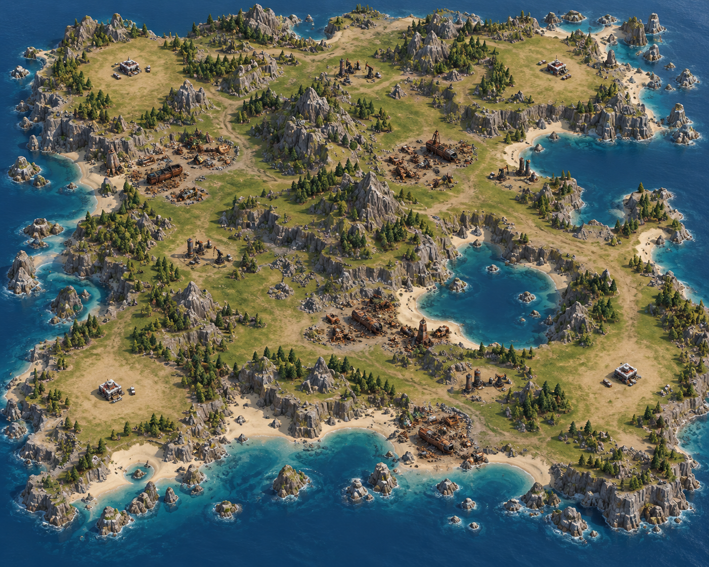
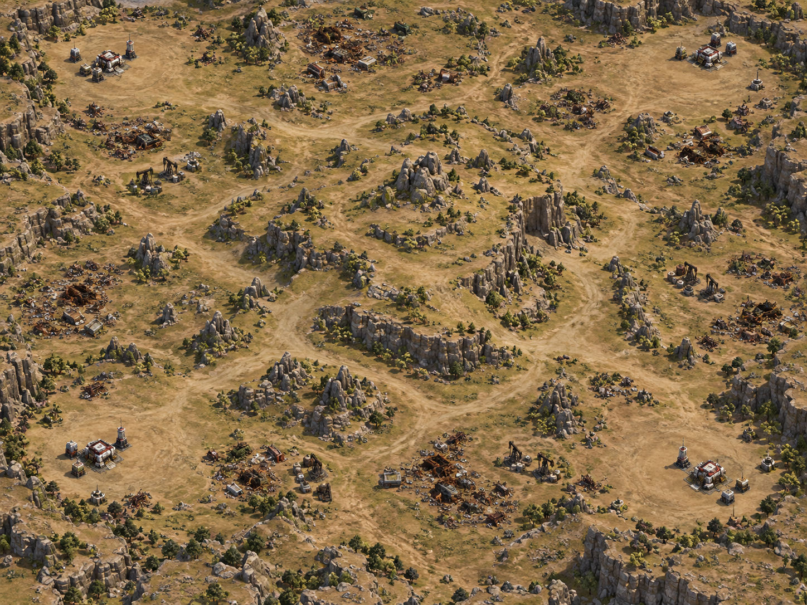
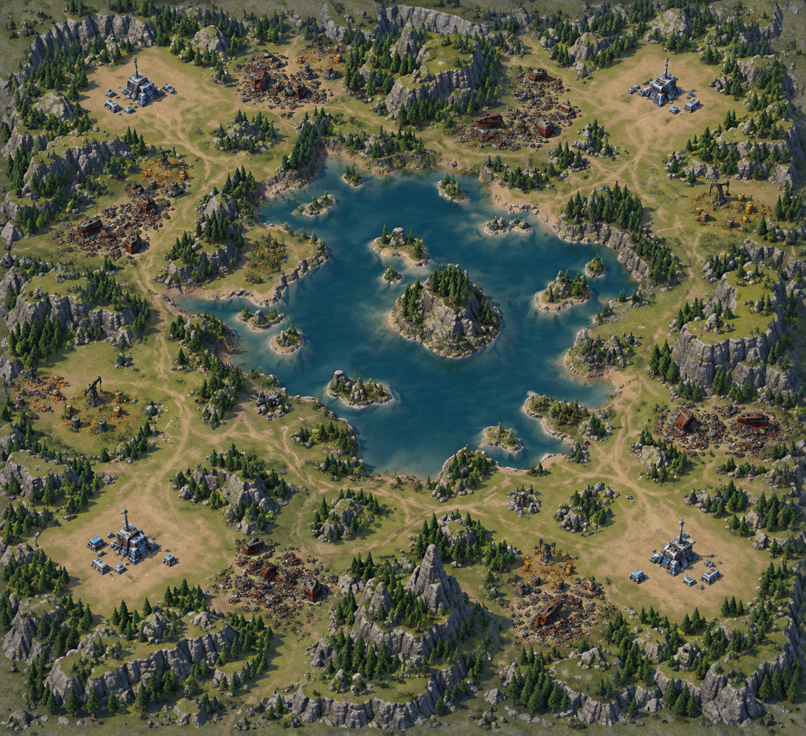
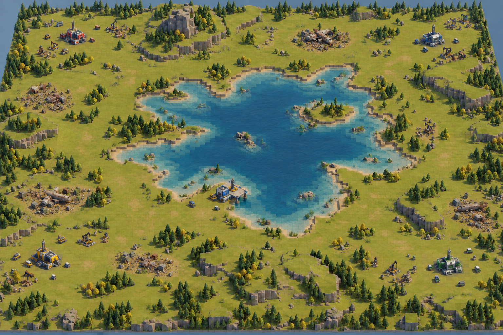
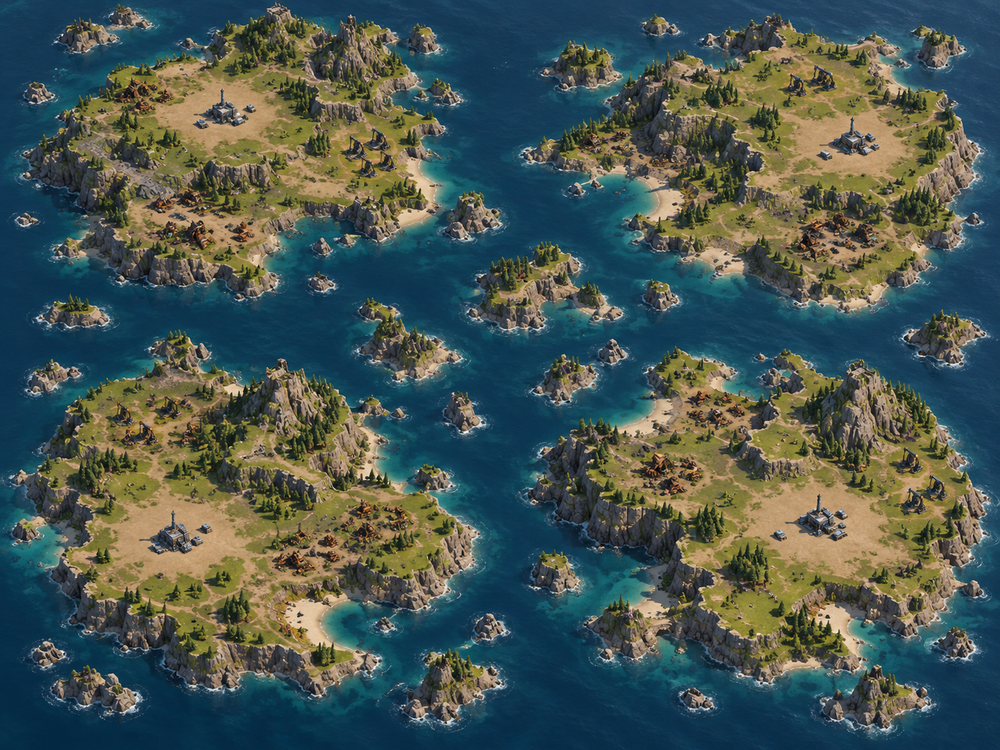

# V2 layout concept images

Generated illustrations for [Terrain Generation V2](../../TERRAIN_GENERATION_V2.md).
These are visual proposals, not engine screenshots or verified generation results.
Tile geometry, building scale, resource counts and support ratios are illustrative.
Rock shapes and cliff density are artistic examples, not exact cell meshes or generation targets.

Each image uses an elevated view, coherent stepped terrain, broad selected ramps, usable opening
clearings and clustered salvage. Both plains examples and the upland example show dry outcomes.
Coastal, lake and island examples show their distinct water topology. Archipelago remains a terrain
preview until supported cross-island progression exists.

Generated using the built-in image generation tool. The complete prompts are saved in
[prompts.json](prompts.json).

## Open plains / arid

## Open plains / temperate

## Rolling hills / upland

## Continental / coastal

## Central hill / dry

## Central water / lake region

### Central Water — implementation concept

A closer visualization of the proposed small square elevation cells, stepped lake bed, broad ramps,
connected surrounding land and shoreline foundations. This is generated concept art, not a capture
of an implemented generator; exact support ratios and foundation depths require engine validation.
Generated with the built-in image tool; [original prompt](central-water-implementation-prompt.json)
and [road-removal edit prompt](central-water-implementation-no-roads-prompt.json).
The current version represents movement corridors through open natural terrain, without generated roads.

## Archipelago / island profile

## Current engine implementation

Actual captures from the first replacement implementation are kept separately in the
[engine capture gallery](implementation/README.md). Concept art above remains design guidance.
