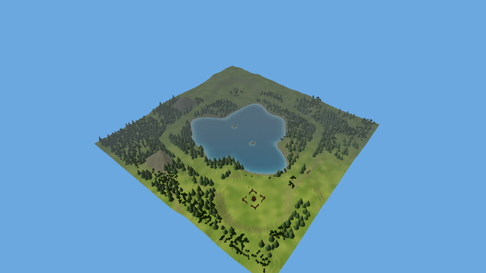
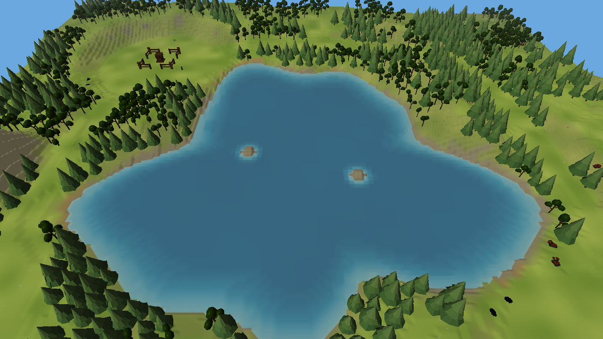
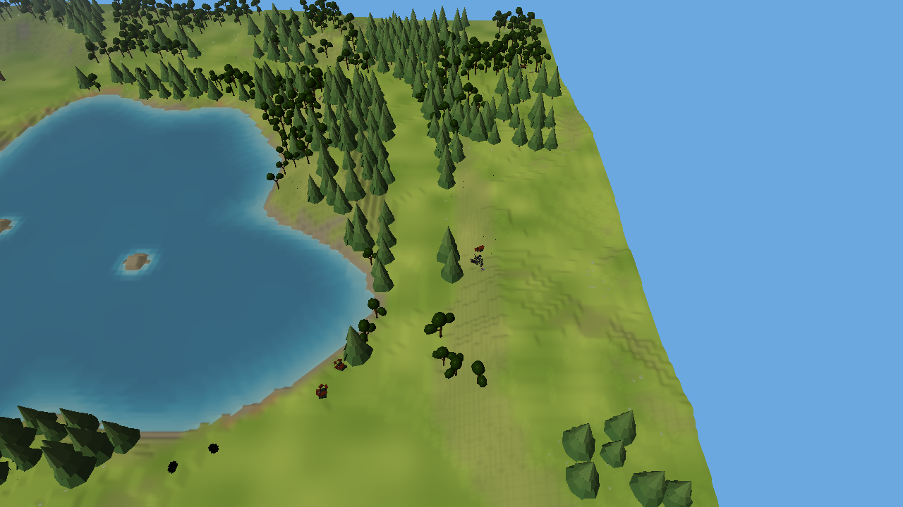
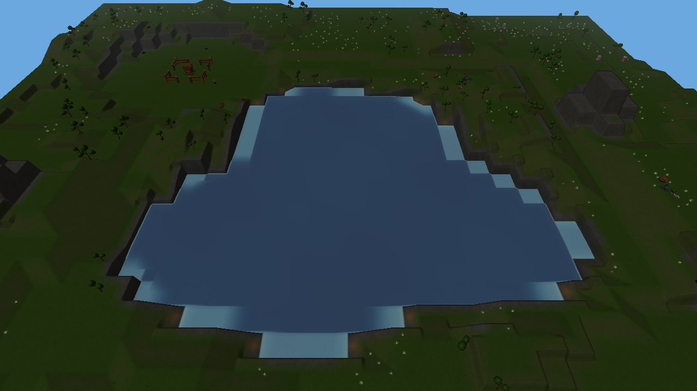

# Refined V2: engine captures

These are actual renderer captures, not generated concept illustrations. They show seed 7,
Small (240 by 240 units), two players, and the recipes in
[terrain/v2.json](../../../../assets/gameplay/terrain/v2.json).

The overview images show geometry and water. The Central Water play views additionally include
starting buildings, resources and visual vegetation. Current recipes use 1.5-unit cells and
half-unit elevation steps, mixed broadleaf/conifer forest groups and separate lake-bank widths. Routes reserve clear traversable land; no
roads are generated. V1 remains selectable separately.

| Layout | Terrain overview |
|---|---|
| Open Plains | [Capture](open_plains.png) |
| Rolling Hills | [Capture](rolling_hills.png) |
| Central Hill | [Capture](central_hill.png) |
| Central Water | [Capture](central_water.png) |
| Continental (dry V2 recipe) | [Capture](continental.png) |

See [implementation and verification](../../../TERRAIN_GENERATION_V2_IMPLEMENTATION.md) for current
scope and limitations. These captures verify the current geometry direction; they do not imply
finished salvage art, water effects, Shore buildings or naval gameplay.

## Comparison

The previous six-unit terrain cells produced large blocky banks and peaks:

The current play-view captures use the same seed, map size and camera positions. Terrain is
articulated more finely; the basin has shallow margins and small islets; forest groups contain
both broadleaf and original conifer models. Resource field inventories are unchanged.
