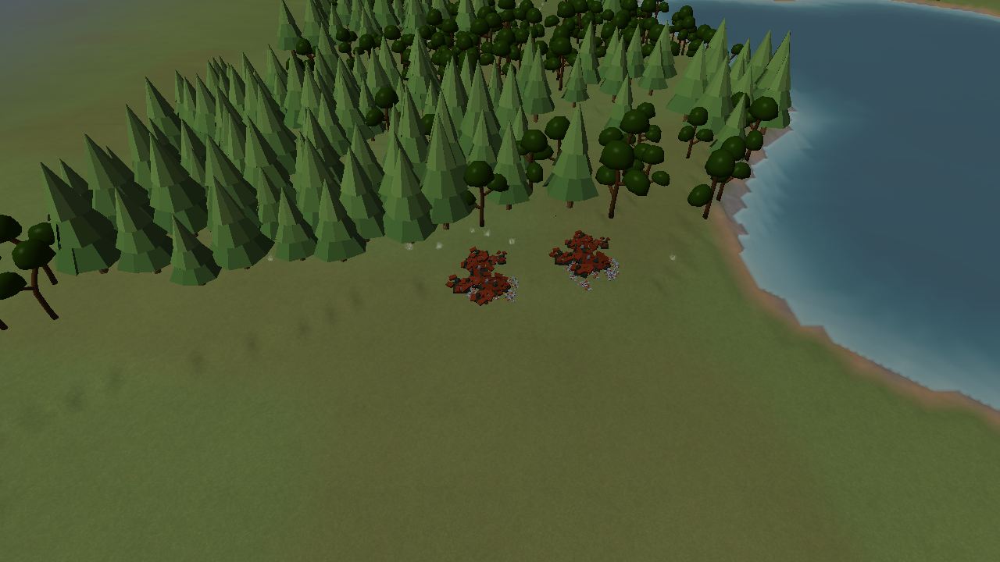
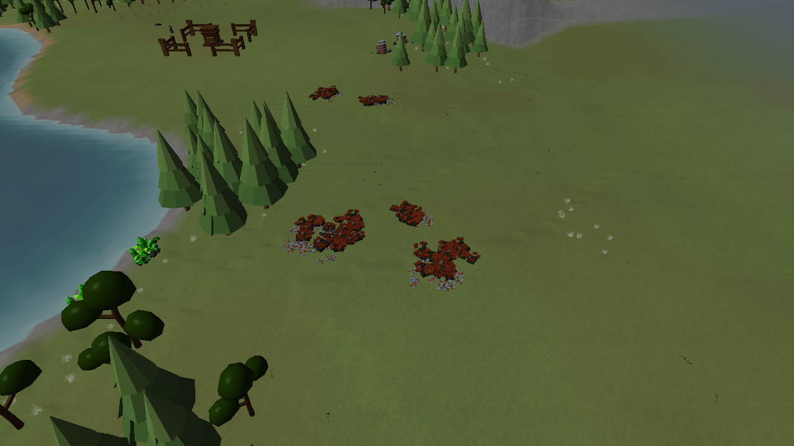
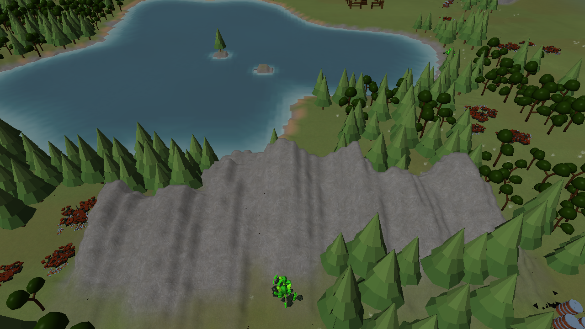
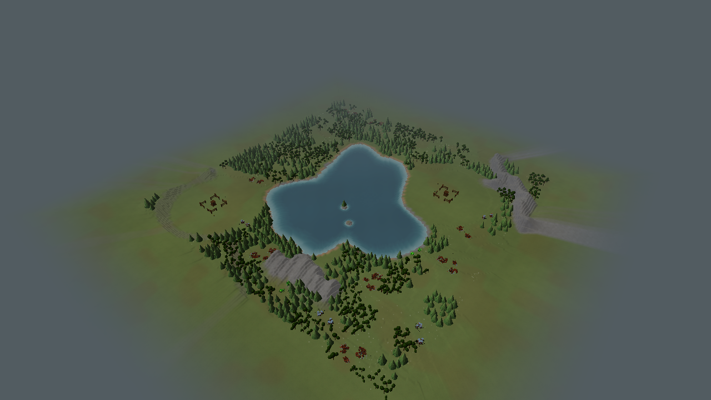

# V2 revision 4: connected cliffs and compound resource fields

Actual Release renderer captures, seed 7, Small (240×240), two players. Central Water play views
include vegetation, buildings and fixed-inventory resources. Additional terrain-only overviews compare
seed 1 and 12345 for Central Water and Rolling Hills. No roads are painted or generated.

The asymmetric ridge profile has a broad climbing back and a narrow escarpment, with overlapping
segments and lower branches. Water and starting construction cores retain their protections.
Each deposit is a single selectable harvest target containing many baked piles/pieces; the visual
increase does not add resource capacity or more simultaneous harvesting targets.

| Layout | Seed 7 | Seed 1 | Seed 12345 |
|---|---|---|---|
| Central Water | [View](central_water.png) | [View](central_water-seed-1.png) | [View](central_water-seed-12345.png) |
| Rolling Hills | [View](rolling_hills.png) | [View](rolling_hills-seed-1.png) | [View](rolling_hills-seed-12345.png) |
| Open Plains | [View](open_plains.png) | — | — |
| Central Hill | [View](central_hill.png) | — | — |
| Continental | [View](continental.png) | — | — |

The other Central Water play captures (`central-water-play-0` through `-4`) show the centre and
four map sides. The fixture also runs 80 moving-camera frames across shores, cliffs and boundaries.

Final verification: 18 captures and the movement pass completed successfully in Release. The full
32-test Debug suite passed, followed by five affected checks after the fixture's Release shader-reload
expectations were corrected. Debug supports hot reload; Release correctly retains its compiled program.
