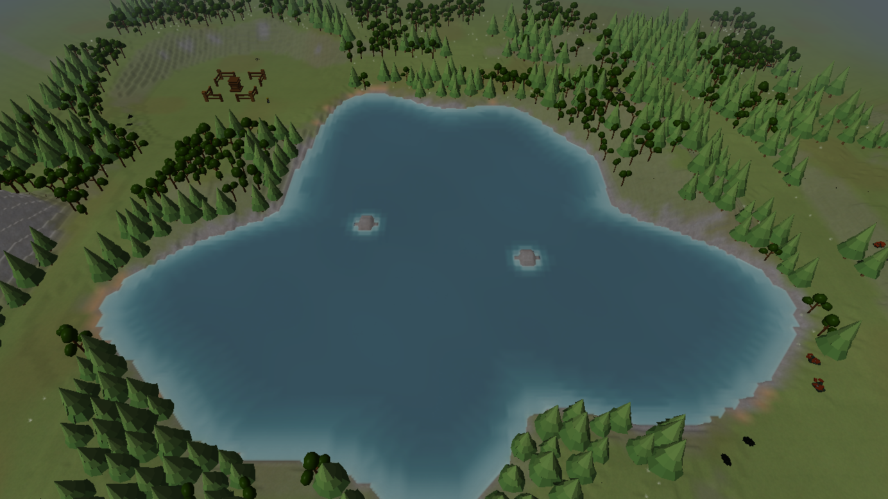
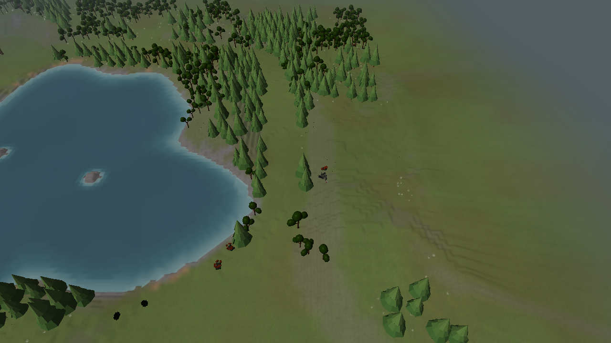
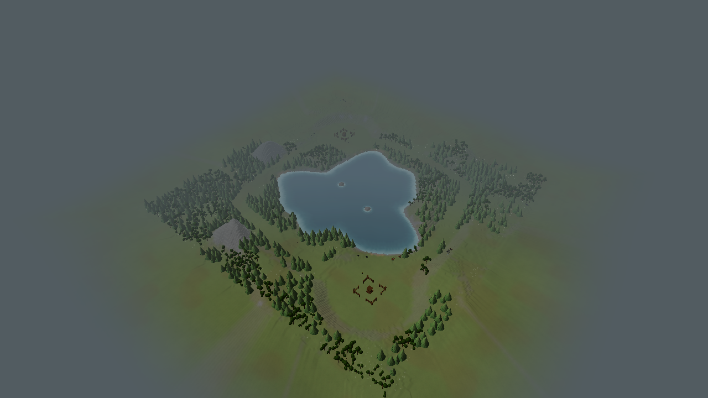

# Natural-material engine captures

Seed 7, Small map, actual renderer captures after the 2026-10-11 ground and boundary
presentation pass. Geometry, resource distribution and vegetation are unchanged.
The previous captures remain one directory up for comparison.

The other play captures show west (1), north (3) and south (4).
The five layout-name images show terrain-only overviews.

See [implementation and verification](../../../../TERRAIN_V2_PRESENTATION.md).
