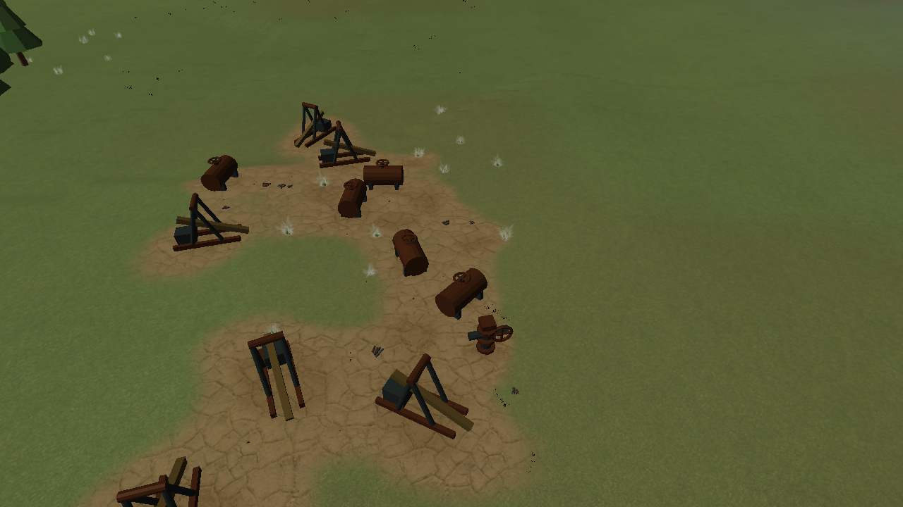
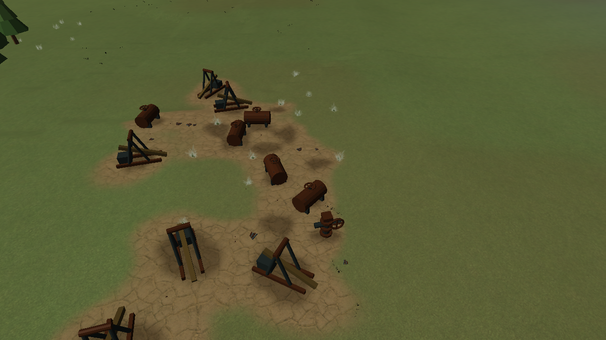
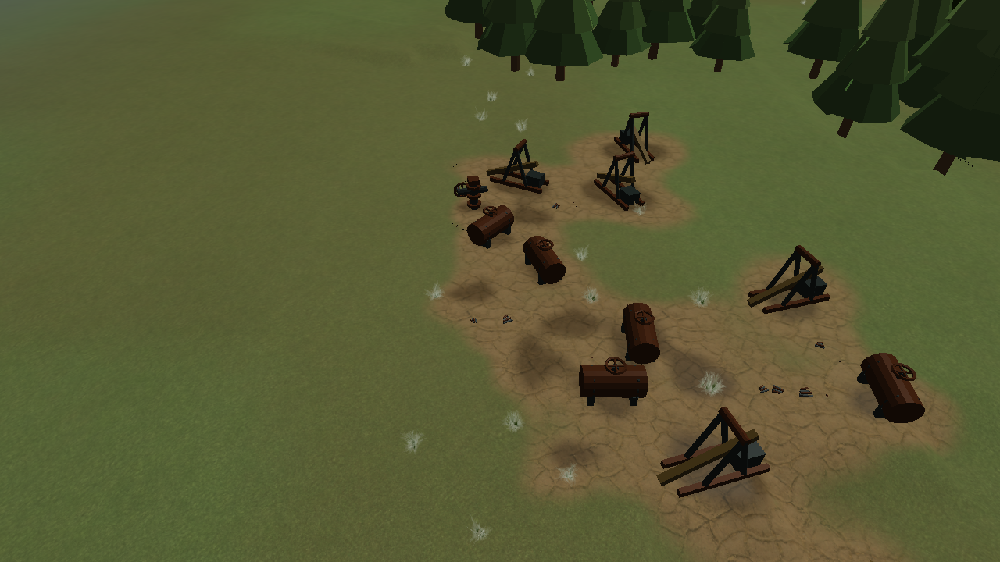

# Oil spills as terrain material

Actual Release renderer captures, 2026-10-22. Central Water, seed 7, Small map, opposite close views.

The latest tuning substantially lightens the warm-brown stain to avoid a shadow-like appearance:

Earlier, darker tuning from the same camera positions:

V2 seep polygons and the flat patches beneath V2 wellheads are removed. Compact wet cores use the
resource-site texture's alpha channel; broader cracked earth uses green. Soft brown staining and
restrained sheen follow the terrain directly, with no additional overlapping surface or depth bias.
The site texture retains dirty-tile caching. Wet cores do not spread along the links between nodes.

Seeps retain their gameplay entities, supply and selection footprint. Their `terrainSurface`
presentation intentionally has no model and does not display a loading/error marker. Depleted seeps
stop being pickable; ground scars persist as before. Resource budgets, V1 and generation revision 7
are unchanged. Restart the game to reload the rebuilt models and presentation catalogue.

Verification: Release renderer fixture passed, including 24 captured views across five layouts,
opposite close Oil views and 80 continuous moving frames. Regression checks verify model-free asset
readiness, live/depleted seep picking, compact wet-mask coverage, cached reconstruction and removal.
Release resource-site, asset-import, definition-validation and gathering tests passed (4/4).
Release and Debug game builds succeeded. Debug resource-site and renderer checks also passed.

The subsequent selection change makes single-click select a whole field, with its total remaining
supply and live node count. Double-click selects a single node. HUD and selection regressions cover
mixed node variants, neighbouring fields, family isolation and depletion down to one or zero nodes.
Release and Debug focused HUD/cache checks passed; the latest Release renderer capture pass also
passed. These images review terrain appearance; the click interaction is covered by selection/HUD
model checks and compiled PlayState input integration.
