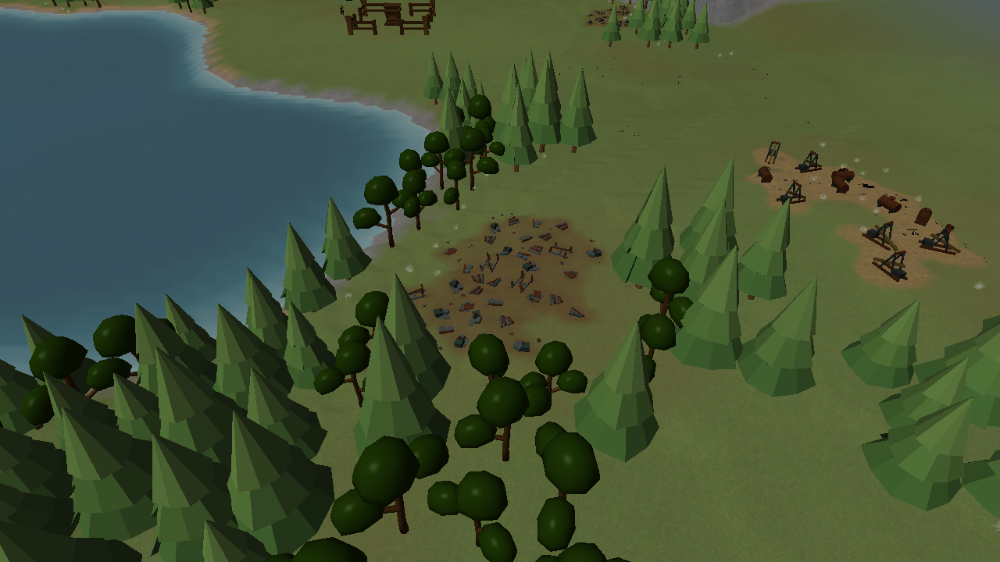
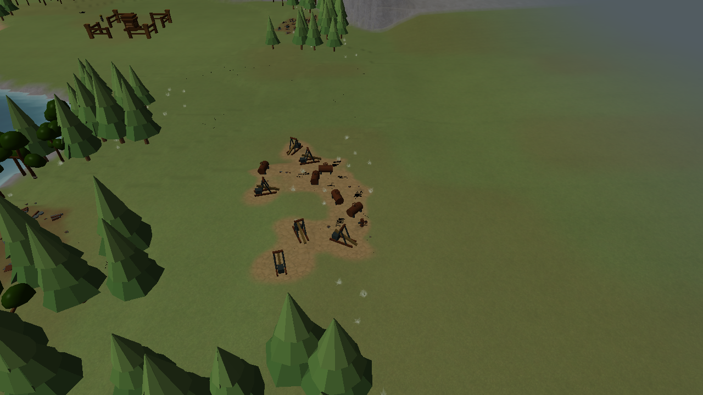
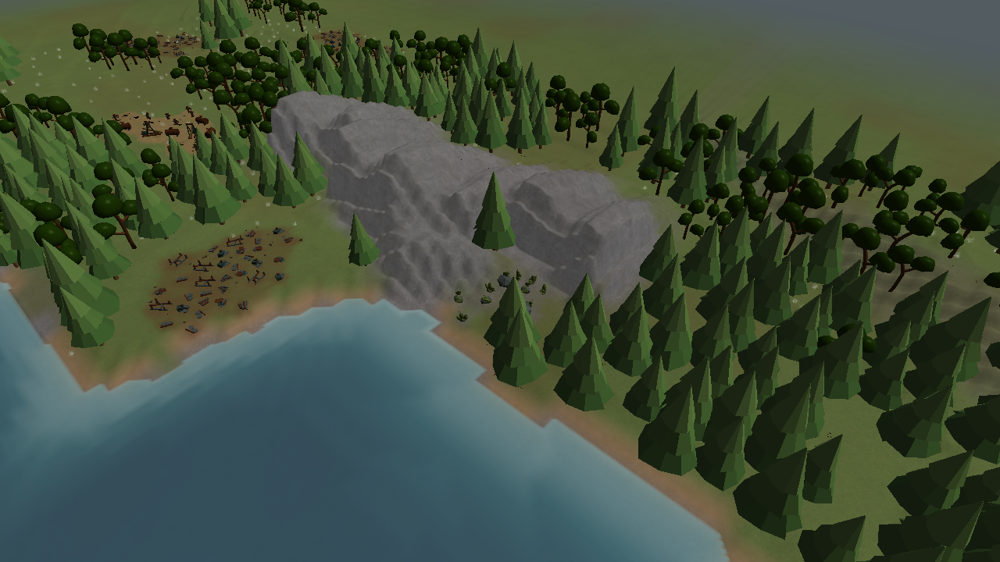

# Connected resource rubble

Actual Release renderer captures, 2026-10-22: Central Water, seed 7, Small map.
Tiny decorative fragments connect nearby nodes of the same field along short, gently bent trails.
Separate fields stay separate. Water, steep edges, structures and protected opening space can
interrupt a trail. The fragments are unharvestable, nonblocking and clear on building placement.

The renderer fixture captured 22 views and exercised 80 continuous moving frames successfully.
The 20-chunk, 2554×1389 render-only probe averaged 10.09 ms over 100 measured frames on a GTX 1070,
with 1,134 resource targets and zero steady-state chunk rebuilds or instance/site uploads.
This probe ran alongside a C++ build and excludes simulation, UI and buffer swapping; it does not
establish full-game frame rate or a controlled performance comparison.

Generation checks cover all five layouts, deterministic reconstruction after depletion, placement
exclusions, and a same-field versus separate-field connection regression. Resource budgets and
V2 generation revision 7 are unchanged. Reload or regenerate a V2 match to reconstruct the visuals.

Release and Debug game builds succeeded. All 33 Release tests passed (146.80 seconds), along with
the focused Debug opening-generation and renderer tests (2/2, 54.76 seconds). `git diff --check`
passed.
