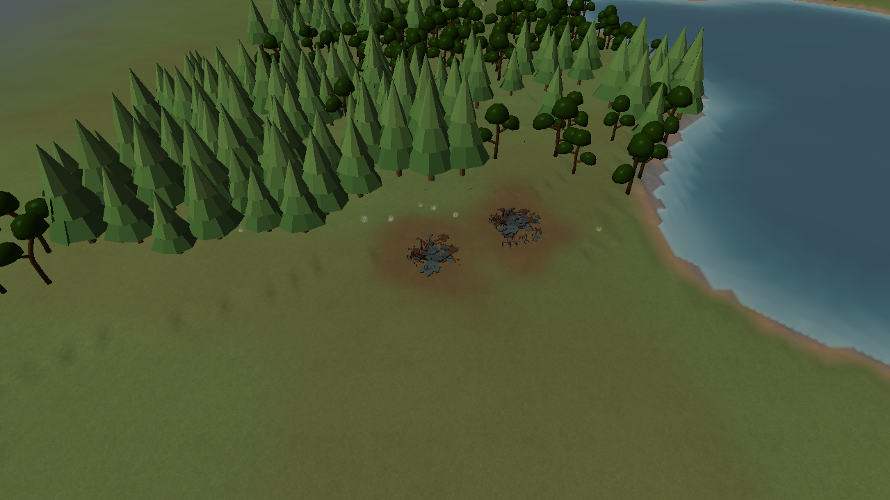
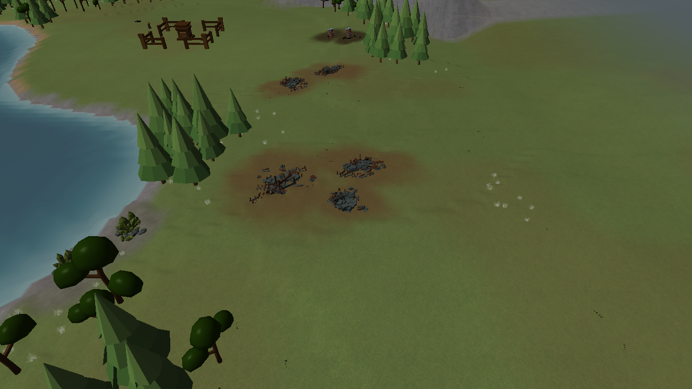
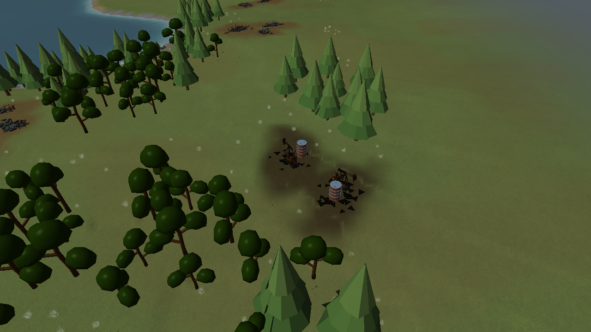
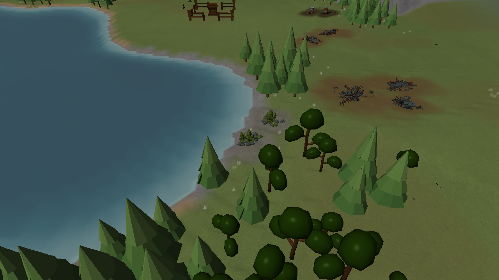
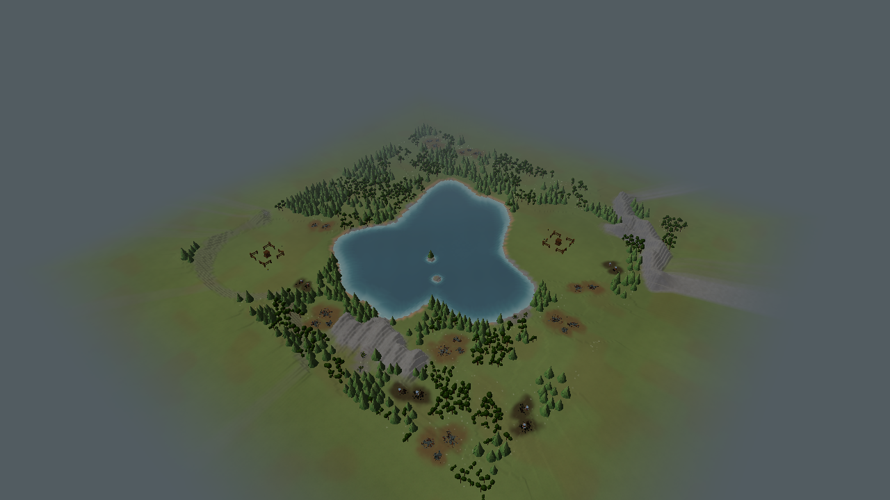

# V2 revision 5: resource sites

Actual renderer captures for Central Water, seed 7, Small (240×240), two players. These are engine
captures, not generated concept illustrations. The appearance pass follows the background reference's
site → concentrations → pieces hierarchy, while retaining existing inventories and harvest targets.

cin

Scrap gains muted steel, six procedural small silhouettes and an occasional broken-frame landmark.
Oil combines low source geometry, equipment and dark ground. Uranium has host rock and subdued
mineral exposures. Shared irregular ground masks and canopy clearance connect the concentrations;
the visible site envelope does not become an additional collision object or resource inventory.

The gallery also contains five terrain-only seed-7 overviews, seed 1/12345 comparisons for Central
Water and Rolling Hills, and play views 0–4 for the centre and map edges. The fixture exercises 80
moving-camera frames. Use `STRATEGY_TERRAIN_SCREENSHOTS` to export all 20 views and
`STRATEGY_RENDER_PROFILE=1` for the opt-in largest-map render-only probe.

Compared with the [preceding compounds](../cliffs-and-clusters/README.md), this pass changes the
shared surface and composition, not harvest-target granularity. Piles still deplete as whole targets;
ground scars remain while the corresponding resource entities exist. Progressive erosion and finer
collision/picking remain separate source/node design work.

Verification: all 33 Debug tests passed, followed by six affected checks after final presentation and
adapter-preference refinements. The Release run completed all 20 captures, 80 moving-camera frames
and the cache/readback checks with no OpenGL errors. On the GTX 1070, the largest-map render-only
probe averaged **8.77 ms** at 2554×1389, with 108 resource targets, repair level 0, zero site-tile uploads
and zero vegetation cache rebuilds/uploads after warm-up. Simulation, UI and swap throttling are excluded.
