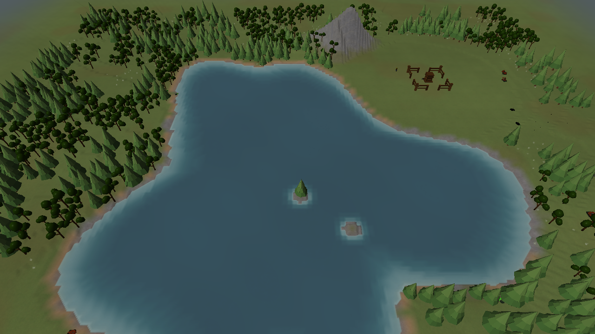
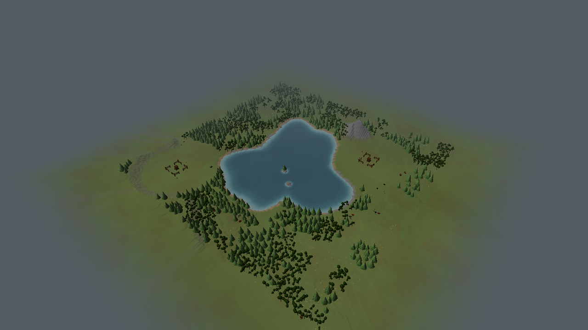

# Seeded landform engine captures

Actual renderer captures from the 2026-10-14 V2 update. All overviews use the same
camera and Small (240 by 240 units) map. The layout-name images use seed 7;
Central Water and Rolling Hills also have seed 1 and seed 12345 comparisons.
These are engine captures, not generated concept art.

| Layout | Seed 1 | Seed 7 | Seed 12345 |
|---|---|---|---|
| Central Water | [View](central_water-seed-1.png) | [View](central_water.png) | [View](central_water-seed-12345.png) |
| Rolling Hills | [View](rolling_hills-seed-1.png) | [View](rolling_hills.png) | [View](rolling_hills-seed-12345.png) |

Other terrain overviews: [Open Plains](open_plains.png),
[Central Hill](central_hill.png), [Continental](continental.png).

The six Central Water play views add starting buildings, resources and vegetation.
View 0 shows the centre; 1-4 show the four map edges; 5 shows the whole map.
Starts vary by seed and are not restricted to the illustrated map corners.

The fine cells, natural material palette and cached outer backdrop remain. Ridge groups,
lake proportions and starting positions are seeded; the old four-sided route ring is removed.
No roads are generated. Low-poly trees/building placeholders remain existing art limitations.

See [implementation and verification](../../../../TERRAIN_GENERATION_V2_IMPLEMENTATION.md).
